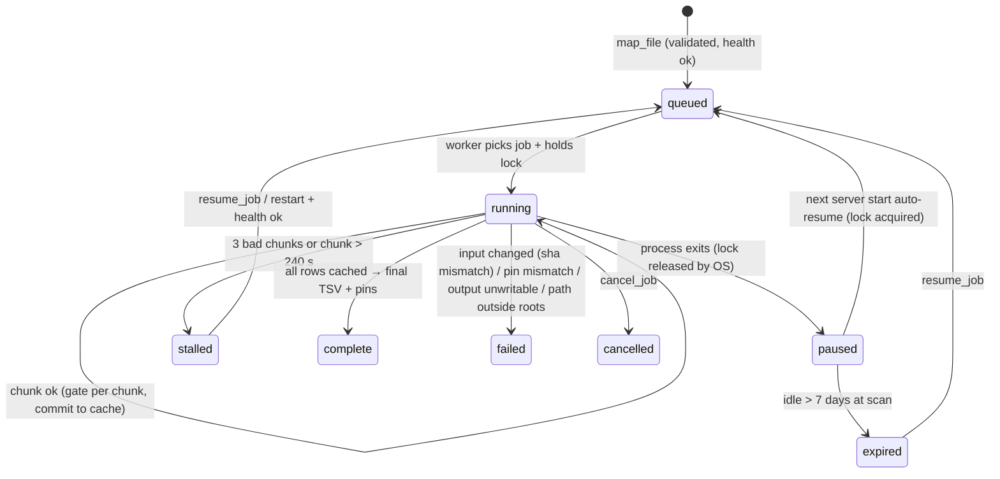

# feat: BioMapper MCP server

**Target repos:** `biomapper` (this repo; Units 1-5). `biomapper2` engine (Unit 0, separate PR).

## Overview

Add a local stdio MCP server to the `biomapper` PyPI client so researchers can use BioMapper entity resolution from Claude Code, Claude Desktop, and other MCP clients. The server exposes discovery, single and small-batch mapping, and resumable background file-mapping jobs over the public keyless API. Before any public listing, it adds guards against overloading the single fragile prod instance: a per-process request gate, a loop guard, and a server-side rate limit in the engine. (See origin: `docs/brainstorms/2026-11-03-mcp-server-requirements.md`.)

## Problem Frame

The preprint needs a citable agentic path next to the Python client. Prod runs about 4.4 s/entity, slows superlinearly with batch size, and wedges under concurrent load. Every design choice below prioritizes keeping prod healthy over raw throughput (see origin).

## Requirements Trace

- R1 stdio server in the PyPI package, one-command launch → Units 2, 5
- R2 public API via existing client; base URL + Kestrel URL env overrides; optional key → Unit 3
- R3 map one entity → Unit 3
- R4 small batch, hard cap, refusal points to file tool → Unit 3 (cap lowered to 5; see Key Decisions)
- R5 discovery → Unit 3
- R6 background file job: validate, writable output, chunked batches, cached, resumable, path allow-list, cancel/rerun → Unit 4
- R7 job status (states: queued, running, paused, stalled, expired, cancelled, complete, failed) → Unit 4
- R8 one in-flight request per process, interleaving, per-job lock → Units 3, 4
- R9 health gate + mid-job stall → Unit 4
- R10 throughput-aware tool descriptions → Unit 3
- R11 honest provenance pins → Units 1, 3, 4
- R12 tagged PyPI release → Unit 5
- R13 README config + worked example → Unit 5
- R14 MCP registry listing, after R15 → Unit 5
- R15 server-side rate limit → Unit 0
- R16 rolling-window loop guard → Unit 3
- Success criteria (agent-behavior trials, `/health` between chunks, under-5-minute setup) → Unit 5 operator verification

## Scope Boundaries

- No hosted/remote MCP endpoint. No Kestrel passthrough tool. No harmonization tools. One running job at a time per process (see origin).
- No change to engine mapping behavior or API surface. The engine change is limited to rate-limit configuration (Unit 0).
- No use of `/map/dataset/stream` (origin R6).

### Deferred to Separate Tasks

- Unit 0 engine rate limit: separate PR in `biomapper2` (fork `trentleslie/biomapper2` base `dev` first, then org). Applying nginx config on the Lightsail host is Trent's operational step.
- Live verification in Claude Code + Claude Desktop, PyPI publish, and `mcp-publisher publish`: operator steps that run after merge (Unit 5 checklist). Automation cannot drive Claude Desktop or the publishing accounts.

## Context & Research

### Relevant Code and Patterns

- `src/biomapper/client.py` `BioMapperClient`: async context manager. Takes `base_url`, `api_key`, `anonymous`, and `timeout` (default 30 s, too short for a chunk). `map_entity` raises typed exceptions. `map_entities` turns 429/5xx/timeouts into per-row `error` results and sleeps on `Retry-After` itself, so the job loop must read error rows.
- `src/biomapper/mapper.py` / `dataset.py` sync helpers use `asyncio.run`. Never call them from the server.
- `src/biomapper/benchmarks/checkpoint.py` `EntityCache`, `cache_key`, `CachePinMismatch`: stdlib-only, fsynced, error-free, with pin checking. The pandas cost comes only from `benchmarks/__init__.py`.
- `src/biomapper/benchmarks/provenance.py` move+re-export pattern for `_provenance.py`, with identity tests and the `tests/test_cohorts_imports.py::test_import_works_without_pandas` subprocess test.
- `src/biomapper/cohorts.py`:
  - `_collect_pins` (never-raise, honesty labels, but needs a cohort `mapper` arg) and `_api_health` (sync).
  - `_read_delimited` (stdlib csv, `.csv` → comma else tab, `utf-8-sig`, drops `#` lines) and `_blank` / `clean_id`.
  - `DEFAULT_BATCH_SIZE = 10`, `DEFAULT_TIMEOUT_S = 300.0`, `API_HEALTH_TIMEOUT_S = 15.0`.
  - Output writers via `csv.writer`. Never write absolute paths into outputs.
- `src/biomapper/_provenance.py` `fetch_kg_build_info` (sync, never raises) and `_version.resolve_version()` (mandatory, enforced by `tests/test_version.py`).
- Optional-import pattern: a local `try: import X except ImportError` with an install hint (`client.py` tqdm, `extras/metabolon/export.py` openpyxl).
- Tests: flat `tests/test_*.py`, `asyncio_mode = "auto"`, respx mocks, `tests/conftest.py` fixtures (`SAMPLE_API_RESPONSE`, `make_batch_response`), 80% coverage floor.
- Engine: `src/biomapper2/api/main.py` mounts the mapping router at both `/api/v1/map` and `/map`. Prod runs `deploy/biomapper2-api.service` (uvicorn `--workers 2`, binds `0.0.0.0:8001`) behind nginx on the same host, which sets `X-Real-IP` / `X-Forwarded-For` (`deploy/README.md`). biomapper-ui calls the engine via the public URL from the same Lightsail host. nginx's default `proxy_read_timeout` is 60 s, shorter than a slow chunk.

### Institutional Learnings

- Extras must be `optional = true` main dependencies, not groups (CHANGELOG 1.5.3). `tests/test_packaging_extras.py` and `scripts/check_wheel_extras.py` gate this against the built wheel.
- Test against real prod payloads, not hand-built fixtures (vault `docs/solutions/integration-issues/hand-built-fixture-hid-a-live-production-bug-2026-09-23.md`). If every row in a batch carries the same error, report one systemic failure.
- `map_entities` aligns results by position and only warns on length mismatch (`docs/solutions/logic-errors/benchmark-harness-reports-plausible-wrong-number-2026-09-23.md`). The MCP layer treats a mismatch as a chunk failure.
- Key caches on the work, not on a timestamp. Resume is the default. Check pins before reuse (vault `.../gated-decision-population-mismatch-and-cache-resumption-2026-08-31.md`).
- Do not re-export a same-named symbol at the package root that shadows the submodule (`.../package-root-reexport-shadows-submodule-2026-09-23.md`).
- An empty body or empty result is an unknown error, never "no match".
- Release is a manual `&&` chain using `python3`, with the wheel-extras check before upload. Changes go fork-first, then sync to the org via a merge commit.

### External References

- MCP Python SDK 2.x (`mcp` 2.3.0, py≥3.10): `MCPServer`, `ToolError` → `is_error`, lifespan context, in-memory `Client(server)` tests. Depends on `httpx2`, not `httpx`, so it does not conflict with `httpx ^0.27`. https://py.sdk.modelcontextprotocol.io/ (migration guide: /migration/)
- MCP Registry `server.json` (schema 2025-12-11): PyPI package with `runtimeHint: uvx`, and an `mcp-name: io.github.<user>/<name>` marker in the published README. It is undocumented whether a pip extra can be expressed. https://github.com/modelcontextprotocol/registry/tree/main/docs
- Claude Code: stdio servers live for the session; shutdown is SIGINT then SIGKILL within about 0.5 s. **Claude Desktop cancels tool calls at a hard-coded ~60 s and ignores timeout settings.** https://code.claude.com/docs/en/mcp
- nginx `limit_req` / `limit_conn`: one shared zone across workers, applied before Python runs. https://nginx.org/en/docs/http/ngx_http_limit_req_module.html

## Key Technical Decisions

- **SDK: `mcp>=2.3,<3` (`MCPServer` API).** This is new code, so it is built on the current major rather than the FastMCP-era 1.x. The SDK's `httpx2` sits alongside the client's `httpx`.
- **Packaging: an `mcp` optional extra plus a `biomapper-mcp` console script.** Launch with `uvx --from 'biomapper[mcp]' biomapper-mcp`. Without the extra, the console script exits with a clear install hint.
  - Registry risk: if `server.json` cannot express the extra through `runtimeArguments` (checked in Unit 5), **promote `mcp` to a base dependency of `biomapper`**. The server stays in the existing package and no second package is published (Trent, Checkpoint 2). Cost: every `biomapper` install gets the SDK tree, and the SDK enforces `pydantic>=2.12`. The base client's import path stays SDK-free either way.
- **Every tool call must return in well under 60 s (Claude Desktop limit).** Consequences:
  - The interactive batch cap is **5**, not 10 (~22 s at idle; origin R4 said "default 10", and the reduction is forced by Desktop).
  - File-job chunks are also 5, so an interactive call waits at most one chunk for the gate.
  - Gate acquisition has a ~10 s wait budget. If the wait exceeds it, the tool returns a "busy, retry shortly" tool error instead of hanging. Busy refusals do not count toward the R16 loop guard.
  - Every interactive mapping tool body, gate wait included, runs under an `anyio.fail_after(50)` wall-clock deadline. A timeout becomes a "prod slow, use map_file" `ToolError`. This is needed because httpx timeouts are per phase, not a total deadline.
  - The interactive HTTP client timeout is ~35 s. The job client timeout is 300 s, matching `cohorts.DEFAULT_TIMEOUT_S`. Because `BioMapperClient` fixes its timeout at construction, the server opens **two client instances** (interactive and job) behind the one gate. The one-in-flight invariant comes from the gate, not from sharing a client.
- **Two async `BioMapperClient` instances per process (interactive, job), both behind one `asyncio.Lock` "gate"** held for exactly one HTTP request (R8).
  - `map_entities` currently sleeps on `Retry-After` inside the call, which would hold the gate. Add an **additive, default-preserving** keyword (e.g. `sleep_on_rate_limit=True`) to `BioMapperClient.map_entities`; the server passes `False` and does any backoff after releasing the gate.
  - Because `map_entities` turns 429/5xx/timeouts/length mismatch into identical `str(exc)` error rows, systemic-failure detection rests on identical-error matching across the chunk. The job worker takes the gate per chunk and releases it between chunks, so interactive calls interleave.
- **Rolling-window loop guard (R16):** a sliding window of interactive mapping calls, defaulting to 20 calls per 5 minutes. Over the limit, the tool returns a `ToolError` pointing to `map_file`. Discovery and status tools are exempt.
- **Provenance:** factor a mapper-free core out of `cohorts._collect_pins` into a shared private module, keeping the honesty labels. Call it once at server start and once at job start (sync helpers via `asyncio.to_thread`). Interactive results carry a compact `provenance` block (client version, API base URL, KG build plus its label). Job outputs write the full pins JSON.
- **Unknown-KG pins follow the existing `benchmarks/arms.py` `_resume_cache` rule: two unknowns compare equal, so an unknown pin must never be resumed across sessions.** A job may start when Kestrel is unreachable. Its KG pin is `"unknown"`, it is labeled unverified, and status shows `kg_verified: false`. Its cache is valid only for the owning process. On any later resume, the server re-probes Kestrel:
  - If the KG is still unknown, or now known, the unpinned cache is discarded and the job restarts from row 0, with the reason recorded in status.
  - A job pinned to a known build that meets a different known build gets `CachePinMismatch` → `failed`, with a message to submit with `rerun=true`.
- **Path allow-list (security):** `map_file` input and output paths must resolve, with symlinks followed, under an allowed root. Allowed roots are the client-provided MCP roots (Claude Code supplies the project directory) plus any `BIOMAPPER_MCP_ROOTS` (path-list env var). If the client provides no roots and the env var is unset, `map_file` refuses with a message explaining how to set `BIOMAPPER_MCP_ROOTS`. Validation is repeated at resume time.
- **Secrets:** `BIOMAPPER_API_KEY` never appears in `job.json`, pins, provenance blocks, `ToolError` text, or logs. This is enforced by a test.
- **Job state home:** `BIOMAPPER_MCP_HOME`, default `~/.cache/biomapper/mcp`, with directories created `0700` and files `0600`. Each job gets a directory `jobs/<job_id>/` containing `job.json` (input path + sha256, output path, options, state, counters, timestamps), the `EntityCache` files, a lock file, and pins.
  - Re-submitting the same file, options, and output path returns the existing job instead of creating a duplicate, unless `rerun=true`.
- **Per-job ownership lock:** an OS advisory file lock (`fcntl.flock` on POSIX, `msvcrt.locking` on Windows), held while a process owns the job. The OS releases it on process death. The lock file also records `host` and `pid` for diagnostics. A process that cannot get the lock reports the job as `owned_elsewhere`.
  - Network filesystems (NFS/SMB homes) can make `flock` local-only or lease-based. The README documents setting `BIOMAPPER_MCP_HOME` to local disk on HPC/shared hosts. This is accepted for v1.
- **Auto-resume (scoped):** at server start, the lifespan scans `jobs/` for unfinished jobs. It considers only jobs whose input lies inside the current session's allowed roots and that were last active within 7 days. It takes each lock it can get and queues those jobs FIFO. Older jobs become `expired` and resume only through an explicit `resume_job`.
- **Job lifecycle tools:**
  - `cancel_job(job_id)` stops the job (finishing the current chunk), marks it `cancelled`, and keeps `.partial` and the cache.
  - `map_file(..., rerun=false)`: with `rerun=true` it forces a fresh job and discards the old cache, for a changed KG build or to retry errored rows.
  - `job_status()` with no id lists only jobs inside the current roots.
  - `job_id` derives from the input sha256, the options, **and the output path**.
- **Per-row attempts:** `job.json` persists `attempts: {cache_key: n}` and `pass_index` with the same atomic write. A pass is one in-order sweep over uncached rows. Only per-row errors increment attempts; systemic chunk failures (all rows share one error) do not. A row with 3 attempts is skipped and written as `error` at completion.
- **Stall detection (R9):** a chunk counts as "bad" if it raised or all its rows share one error string (systemic). After 3 consecutive bad chunks, or any chunk slower than 240 s, the job moves to `stalled` and stops sending requests. `resume_job` (or a server restart) retries it after a fresh health check. A health gate runs before start and resume: `/health` must answer within 15 s, probed only while the gate is free.
- **Output:** the default path is `<input_stem>.biomapper.tsv` next to the input, plus `<input_stem>.biomapper.provenance.json`. The tool refuses if the target exists (no overwrite) or the directory is not writable.
  - Progress is written to `<output>.partial` (clearly not final). At completion, the output is rebuilt from cache plus input in input order to a temp file, then renamed atomically to the final path, and `.partial` is removed.
  - `map_file` resolves the `job_id` and returns an existing job **before** the output-exists check. The no-overwrite check applies only to new jobs.
  - Columns, in order: `key, name, identifiers_sent, status, chosen_kg_id, primary_curie, resolved, confidence_score, confidence_tier, refusal_reason, kg_equivalent_ids, error`. These are the cohort mapping TSV columns plus the interactive result fields.
- **Engine rate limit (R15) lives in nginx, not the app.** The mapping routes block the event loop, and counters split across 2 workers, which defeats an in-app limiter. The policy:
  - per-IP `limit_req` plus `limit_conn` on `/api/v1/map/`, returning 429;
  - the biomapper-ui proxy prefixes `/map` and `/discovery` keyed separately, with a looser zone, so UI users are not throttled as one IP;
  - port 8001 restricted to localhost so nginx cannot be bypassed.

## Open Questions

### Resolved During Planning

- Stream vs batch → chunked `map_entities` of 5 (see origin R6; size changed by the Desktop timeout).
- Cache design → reuse `EntityCache`, moved to core.
- Concurrent sessions → per-job OS file lock.
- How the job detects 429/5xx → inspect per-row `error` values; identical errors across a chunk mean a systemic failure.
- Output layout vs cohort layout → sibling TSV + provenance JSON with cohort-compatible columns and pins shape; no run directory. A researcher expects the output next to their file.

### Deferred to Implementation

- Exact rate numbers for nginx zones: start conservative (e.g. 1 r/s burst 10 per IP on the API path, `limit_conn` 2) and tune after observing prod.
- Whether `server.json` `runtimeArguments` can carry `--from 'biomapper[mcp]'`: verify with `mcp-publisher` validation in Unit 5. If not, `mcp` becomes a base dependency (decided).
- Exact ETA smoothing: an exponential moving average of the observed seconds per row, seeded at 4.4 s.
- Windows lock semantics: verify `msvcrt.locking` behavior in CI only if a Windows runner is cheap; otherwise document it as best-effort.

## Output Structure

    src/biomapper/
      _checkpoint.py            # moved EntityCache/cache_key/CachePinMismatch
      _pins.py                  # mapper-free pin collection (from cohorts._collect_pins)
      mcp/
        __init__.py             # import gate with install hint
        __main__.py             # python -m biomapper.mcp
        server.py               # MCPServer, lifespan, tool registration
        gate.py                 # shared client + request gate + loop guard
        tools.py                # discovery / map_entity / map_batch shaping
        jobs.py                 # job registry, lock, worker, status
    tests/
      test_checkpoint_move.py
      test_pins.py
      mcp_server/              # not `mcp/`, to avoid shadowing the SDK
        test_server_tools.py
        test_gate.py
        test_jobs.py
        test_packaging_mcp.py
    server.json

## High-Level Technical Design

> *This illustrates the intended approach and is directional guidance for review, not implementation specification. The implementing agent should treat it as context, not code to reproduce.*

## Implementation Units

- [ ] **Unit 0: Engine rate limit (biomapper2, separate PR)**

**Goal:** Bound aggregate load on prod regardless of how many MCP users exist (R15).

**Requirements:** R15; gates R14.

**Dependencies:** None. Must be live on prod before the Unit 5 registry publish, but does not block Units 1-4 or the PyPI release.

**Files (biomapper2):**
- Create: `deploy/nginx/biomapper2-ratelimit-zones.conf` (http context, goes to `/etc/nginx/conf.d/`), `deploy/nginx/biomapper2-ratelimit-locations.conf` (included in the certbot-managed `server` block; each limited location repeats `proxy_pass http://127.0.0.1:8001`, the `X-Real-IP` / `X-Forwarded-*` headers, and `proxy_read_timeout 300s`)
- Modify: `deploy/README.md` (apply/verify steps, port-8001 firewall check, how to read 429s in logs)
- Modify (separate follow-up commit/PR, merged only after the nginx config is live and nothing calls `:8001` directly; `deploy-api.yml` auto-deploys the unit file on merge to `main`): `deploy/biomapper2-api.service` (bind `127.0.0.1` instead of `0.0.0.0` so nginx cannot be bypassed)
- Test: `tests/test_deploy_config.py` (static checks)

**Approach:**
- Per-IP `limit_req_zone $binary_remote_addr` on **both** mapping mounts (`/api/v1/map/` and the `/map/` alias, which reach the same handler), returning `limit_req_status 429`.
- A **global** `limit_conn` zone keyed on `$server_name` (cap 2, matching `--workers 2`) on both mapping mounts, so aggregate load is bounded regardless of user count.
- biomapper-ui calls the engine through the public URL **from the same host**, so all UI users share the host's IP. A `geo` map exempts the host's own IP and `127.0.0.1` from the per-IP zone (empty key). They stay under the global cap.
- Discovery and health stay unthrottled or loosely throttled.
- Confirm that `request.client.host` resolves correctly behind nginx, which matters only for logs.

**Test scenarios:**
- Happy path: the config file declares a zone for the API mapping path and sets the 429 status.
- Edge case: `/api/v1/map/` and `/map/` both carry the per-IP and global limits.
- Edge case: the `geo` exemption covers the host IP and `127.0.0.1`.
- Happy path: every limited location repeats `proxy_pass` and `proxy_read_timeout`.
- Error path: the unit file does not bind `0.0.0.0` (guards against regression).

**Verification:** after Trent applies it on the host, a burst of more than the limit from one IP gets 429 while `/api/v1/health` stays fast, and port 8001 is unreachable from outside.

- [x] **Unit 1: Move EntityCache to core and factor mapper-free pins**

**Goal:** Make the resumable cache and the honest pin collection importable without pandas (R6, R11).

**Requirements:** R6, R11.

**Dependencies:** None.

**Files:**
- Create: `src/biomapper/_checkpoint.py`, `src/biomapper/_pins.py`
- Modify: `src/biomapper/benchmarks/checkpoint.py` (re-export in the `from X import Y as Y` style), `src/biomapper/cohorts.py` (`_collect_pins` delegates to `_pins`, output byte-identical)
- Test: `tests/test_checkpoint_move.py`, `tests/test_pins.py`, extend `tests/test_cohorts_imports.py`

**Approach:**
- Move the code byte-for-byte and keep the old import paths working.
- `_pins` returns the same api/kestrel dict with the same labels as today. The cohort function adds its `mapper` keys on top.
- Accept a Kestrel URL parameter that defaults to `_provenance.DEFAULT_KESTREL_URL`, so the server can pass the env override.

**Patterns to follow:** `_provenance.py` move and `tests/` identity re-export tests.

**Test scenarios:**
- Happy path: `biomapper.benchmarks.checkpoint.EntityCache is biomapper._checkpoint.EntityCache`.
- Happy path: `biomapper._checkpoint` and `biomapper._pins` import in a subprocess with pandas blocked.
- Integration: `cohorts._collect_pins` output for a fixed respx-mocked API/Kestrel is identical before and after the refactor (same keys, labels, and values).
- Edge case: Kestrel unreachable → `kg_build` is `"unknown"`, the error is recorded, and nothing raises.

**Verification:** the existing benchmark and cohort tests pass unchanged; the pandas-blocked import test covers the new modules.

- [x] **Unit 2: Packaging — `mcp` extra, console script, import gate**

**Goal:** Make `uvx --from 'biomapper[mcp]' biomapper-mcp` work, with a clear message when the extra is missing (R1).

**Requirements:** R1.

**Dependencies:** None (can land with Unit 3).

**Files:**
- Modify: `src/biomapper/client.py` (additive `sleep_on_rate_limit` keyword on `map_entities`, default unchanged; lands with Unit 3)
- Modify: `pyproject.toml` (`mcp = {version = ">=2.3,<3", optional = true}` in main dependencies; `mcp` extra; add it to `all`; `[tool.poetry.scripts] biomapper-mcp = "biomapper.mcp:main"`; mypy override if needed), `scripts/check_wheel_extras.py`
- Create: `src/biomapper/mcp/__init__.py`, `src/biomapper/mcp/__main__.py`
- Test: `tests/mcp_server/test_packaging_mcp.py`, extend `tests/test_packaging_extras.py`

**Approach:**
- `biomapper/mcp/__init__.py` `main()` tries to import the SDK. On `ImportError` it prints the `pip install 'biomapper[mcp]'` hint to stderr and exits 1; otherwise it imports `biomapper.mcp.server` and runs it. `server.py` may import the SDK at module level.
- `biomapper/__init__.py` does not import `biomapper.mcp` (avoids shadowing).
- Logging goes to stderr only; nothing writes to stdout.

**Test scenarios:**
- Happy path: the built-wheel metadata lists `mcp` under `Requires-Dist` with `extra == "mcp"`.
- Happy path: the console-script entry point is present in the wheel metadata.
- Error path: running `main()` with the `mcp` module blocked exits non-zero with the install hint on stderr.
- Edge case: `import biomapper` does not import `mcp` (checked via `sys.modules`).

**Verification:** CI's wheel-extras check passes with the new extra; `poetry lock` resolves with `httpx ^0.27`.

- [x] **Unit 3: Server core — gate, loop guard, discovery and mapping tools**

**Goal:** Provide interactive tools that are safe under the Desktop 60 s limit and the prod constraints (R2-R5, R8, R10, R11, R16).

**Requirements:** R2, R3, R4, R5, R8, R10, R11, R16.

**Dependencies:** Units 1, 2.

**Files:**
- Create: `src/biomapper/mcp/server.py`, `src/biomapper/mcp/gate.py`, `src/biomapper/mcp/tools.py`
- Test: `tests/mcp_server/test_server_tools.py`, `tests/mcp_server/test_gate.py`

**Approach:**
- The lifespan opens the two `BioMapperClient`s (`base_url` from `BIOMAPPER_BASE_URL`, key from `BIOMAPPER_API_KEY`, else `anonymous=True`) and an anyio task group. It then **starts pin collection (via `to_thread`) and the auto-resume scan as background tasks before yielding**, so MCP `initialize` is never blocked by slow `/health` probes. Tools report pins as `pending` until they land. The job worker awaits pins before its first chunk.
- `gate.py`: an `asyncio.Lock` with a ~20 s wait budget raising a busy `ToolError`, plus the sliding-window loop guard with injectable clock and limits.
- Tools:
  - `list_entity_types`, `list_vocabularies`, `list_annotators`: discovery, gated and lightweight.
  - `map_entity(name, entity_type, identifiers?, annotation_mode?)`.
  - `map_batch(entities ≤5, entity_type, ...)`: over-cap returns a `ToolError` directing to `map_file`.
  - Each returns a structured model with per-entity `status` (`resolved` / `unresolved` / `refused` / `error`), `primary_curie`, `chosen_kg_id`, `confidence_score` + tier, `refusal_reason`, key equivalent ids, and a compact `provenance` block. `raw_response` and `kestrel_results` are dropped to stay well under the output token limits.
- Batch results are aligned to requests by position only after a length check. A mismatch or identical errors across all rows become one systemic `ToolError`, not N rows.
- Typed client exceptions map to readable `ToolError` messages (rate-limited with retry-after, server error, timeout). For `map_batch`, rate limiting shows up as identical error rows and is reported as one systemic error.
- Tool descriptions state about 4-5 s per entity, "call discovery first", "batches up to 5", and "use `map_file` for more" (R10).

**Execution note:** start test-first on the gate and loop guard; they are pure logic with an injectable clock.

**Patterns to follow:** respx mocks with `tests/conftest.py` fixtures; include one test built from a captured real prod `/map/batch` payload.

**Test scenarios:**
- Happy path: `map_entity` for a mocked resolved payload returns `status=resolved`, the CURIE, the tier, and provenance with `client_version` and the KG label.
- Happy path: discovery tools return the parsed lists via the in-memory `Client(server)`.
- Edge case: `map_batch` with 5 entities succeeds; with 6 it returns `is_error` naming `map_file` and makes no HTTP call.
- Edge case: on the 21st interactive call within the window the guard refuses; after the window slides, calls are allowed again; discovery calls do not count.
- Error path: the mocked API returns 429 on `/map/entity` → `is_error` with the retry-after text.
- Error path: a batch where every row has the same error string → one systemic error, not 5 rows.
- Error path: batch length mismatch → error, no misaligned results.
- Error path: an empty or unresolved body → `status=unresolved` with a reason, never a fabricated CURIE.
- Integration: two concurrent tool calls → the second waits for the gate, and at most one HTTP request is in flight (asserted via a respx side-effect counter).
- Integration: the gate is held longer than the wait budget → the second call gets a busy `ToolError` within the budget.
- Integration: a tool whose gated request hangs returns a `ToolError` within the 50 s deadline.
- Integration: MCP `initialize` completes promptly while the mocked `/health` hangs; tools report pins `pending`.
- Integration: `BIOMAPPER_BASE_URL` and `BIOMAPPER_KESTREL_URL` env overrides reach the requests and the pins.

**Verification:** all tools are callable via the in-memory client; no test exceeds one in-flight request; mypy strict passes.

- [x] **Unit 4: File-mapping jobs — registry, lock, worker, status, auto-resume**

**Goal:** Map researcher files of any length as resumable background jobs without overloading prod (R6-R9, R11).

**Requirements:** R6, R7, R8, R9, R11.

**Dependencies:** Units 1, 3.

**Files:**
- Create: `src/biomapper/mcp/jobs.py`
- Modify: `src/biomapper/mcp/server.py` (register tools, start the worker and auto-resume in the lifespan)
- Test: `tests/mcp_server/test_jobs.py`

**Approach:**
- Tools:
  - `map_file(path, name_column, entity_type, identifier_columns?, output_path?)`: validates synchronously, then queues the job. Validation checks that the file exists and is readable, the columns are present, rows are counted via `cohorts._read_delimited` semantics, the output target does not exist and its directory is writable, and the health gate passes. Returns `job_id`, row count, output path, and the initial ETA.
  - `job_status(job_id?)`: one job, or all jobs.
  - `resume_job(job_id)`: for `stalled`, `expired`, or `owned_elsewhere`-then-released jobs.
  - `cancel_job(job_id)`.
- The worker is one coroutine in the lifespan task group and processes jobs FIFO:
  1. Take the gate.
  2. Call `map_entities` on the next 5 uncached rows with a 300 s timeout.
  3. Release the gate.
  4. Commit the good rows to `EntityCache`.
  5. Update `job.json` atomically and append to the progressive TSV.
- Rows that errored are not cached, so they are retried on the next pass. After 3 passes a row is recorded as `error` in the output and the job still completes.
- On resume, recompute the input sha256. If it changed, mark the job `failed` ("input changed").
- A `CachePinMismatch` → `failed` with an explicit message, never a silent mix.
- Shutdown: the lifespan cancels the task group. Job state is already durable per chunk, so cleanup stays well under the 0.5 s SIGKILL window.

**Execution note:** test-first for the state machine (queued → running → complete / stalled / failed / paused) with a fake mapper and a fake clock.

**Patterns to follow:** `EntityCache.commit_batch` / `record_progress` (atomic writes); `cohorts._read_delimited`, `_blank`, `clean_id`; the never-raise pins from Unit 1.

**Test scenarios:**
- Happy path: a 12-row TSV → job completes in 3 chunks, the output has 12 rows in input order, and the provenance JSON is written.
- Happy path: `map_file` returns within a fixed small time budget while the worker keeps running (no blocking on the mapping).
- Edge case: re-submitting the same file and options returns the existing `job_id`, not a duplicate.
- Edge case: the output path exists → refused at validation, nothing queued.
- Edge case: the output directory is read-only → refused at validation.
- Edge case: missing name column / empty file / only `#` comment lines → clear validation error.
- Edge case: the KG pin is unknown → the job runs and status shows `kg_verified: false`.
- Error path: the health probe exceeds 15 s → `map_file` refuses with the "prod slow" message and nothing is queued.
- Error path: 3 consecutive chunks where all rows errored → `stalled` and no further HTTP calls; `resume_job` after a healthy probe continues from the cache.
- Error path: the input is modified between runs → `failed`, "input changed".
- Integration: process A holds the lock → process B's auto-resume reports `owned_elsewhere` and sends no requests. After A's lock is released (simulated process exit), B acquires it and resumes without re-mapping cached rows (asserted by an HTTP call count equal to the number of remaining rows / 5).
- Integration: an interactive `map_entity` issued while a job runs completes between chunks, and at most one request is ever in flight.
- Edge case: a row that errors on every attempt is written as `error` after 3 attempts; a restart does not reset its count (persisted in `job.json`).
- Edge case: a systemic 429 chunk (all rows identical error) does not increment any row's attempts.
- Edge case: mid-run, `<output>.partial` exists and the final path does not; at completion the final file is in input order and `.partial` is gone.
- Edge case: resubmitting a paused job whose `.partial` exists returns the job instead of refusing.
- Error path: unknown-KG job resumed in a new process → cache discarded, restarts from row 0, reason in status.
- Error path: an input path outside the roots, or a symlink inside a root that points outside it → refused at validation and nothing is read.
- Error path: no roots and no `BIOMAPPER_MCP_ROOTS` → `map_file` refuses with setup guidance; the interactive tools still work.
- Edge case: auto-resume skips a job whose input is outside the current roots and a job idle for more than 7 days (it becomes `expired`); `resume_job` still runs the expired job.
- Happy path: `cancel_job` on a running job → no further HTTP calls after the current chunk; state is `cancelled`.
- Edge case: the same file with a different `output_path` → a new job; the same file with `rerun=true` → a new job with a fresh cache.
- Error path: with `BIOMAPPER_API_KEY=secret` set, the string `secret` appears in no file under the job dir, no tool result, and no `ToolError`.
- Integration: an interactive call during a 429 on the job chunk is not blocked by a `Retry-After` sleep (the gate is released before backoff).
- Integration: simulate a crash mid-chunk (the cache has a torn last line) → resume truncates the torn line and re-maps only that chunk.

**Verification:** the state-machine tests and two-process lock test pass; a partial TSV exists mid-run; no row is ever mapped twice after it is cached.

- [ ] **Unit 5: Docs, registry metadata, release, and operator verification**

**Goal:** Make the server installable, citable, and discoverable, and verify it live (R12-R14, success criteria).

**Requirements:** R12, R13, R14; all success criteria.

**Dependencies:** Units 2-4 for release; Unit 0 live on prod for the registry publish.

**Files:**
- Modify: `README.md` (new "Use from an agent (MCP)" section after Harmonization: Claude Code `claude mcp add` line, Claude Desktop JSON with an absolute-`uvx` note, env vars, tool list, throughput expectations, job behavior, hidden `<!-- mcp-name: io.github.trentleslie/biomapper -->` marker), `CHANGELOG.md` (`[Unreleased]` → 1.6.0 Added entry), `pyproject.toml` version bump
- Create: `server.json`, `docs/mcp-worked-example.md` (a supplement-ready transcript, filled in from the live verification run)
- Test: extend `tests/mcp_server/test_packaging_mcp.py` (`server.json` name/version match `pyproject`; README contains the exact marker with no trailing punctuation)

**Approach:**
- Validate whether `server.json` can express `--from 'biomapper[mcp]'` through `runtimeArguments` using `mcp-publisher` validation. If it cannot, move `mcp` from optional to base dependency in the same release, update `test_packaging_mcp.py`, and simplify the README launch to `uvx --from biomapper biomapper-mcp`.
- Registry namespace: `io.github.trentleslie/biomapper`. Moving to `io.github.phenome-health/...` needs org GitHub login and is decided at release.
- Operator checklist (Trent, after merge), recorded in the PR description:
  1. Release 1.6.0 via the manual `&&` chain, with the wheel-extras check before upload.
  2. Run the fresh-machine `uv`-only setup timing (target under 5 min).
  3. Run 5 trials per client (Claude Code, Claude Desktop) of the fixed prompt "map this 500-row file". Pass: at least 4 of 5 start `map_file` and poll, with at most 3 single-entity calls per trial.
  4. Run a deliberate looping test where R16 fires.
  5. Probe `/health` between chunks, expecting under 15 s.
  6. Run `mcp-publisher publish` only after Unit 0 is confirmed live.

**Test scenarios:**
- Happy path: the `server.json` `name`, `version`, and package identifier match `pyproject`.
- Edge case: the README marker regex matches exactly once, and the token is followed by whitespace or a comment close.

**Verification:** 1.6.0 is on PyPI with a working `uvx` launch; the worked example is committed; the registry entry resolves; the preprint Software Availability cites 1.6.0.

## System-Wide Impact

- **Interaction graph:** existing `cohorts.harmonize_cohorts` and the benchmarks suite now import from the moved modules. Identity re-exports keep them unchanged.
- **Error propagation:** client typed exceptions and per-row errors become `ToolError` (the model-visible `is_error`) for interactive calls, and become job state plus per-row `error` cells for jobs. Nothing is silently dropped.
- **State lifecycle risks:** partial writes (atomic `job.json`, fsynced cache, torn-line truncation); duplicate work (job_id from sha + options, cache keyed on the work, OS lock); stale output (refuse to overwrite).
- **API surface parity:** none. The Python client API is unchanged.
- **Integration coverage:** the two-process lock, gate interleaving with a running job, and the real prod payload test.
- **Unchanged invariants:** `biomapper` public API, the cohort output bytes, and benchmark cache compatibility (same file names and pin fields).

## Risks & Dependencies

| Risk | Mitigation |
|------|------------|
| Claude Desktop 60 s cap cancels a call mid-request | Batch cap 5, a 20 s gate wait budget, a 35 s interactive HTTP timeout; all long work runs in jobs |
| Registry cannot express the pip extra | Verify in Unit 5; fallback = `mcp` becomes a base dependency of `biomapper` (no second package) |
| `mcp` 2.x pulls in a heavy dependency tree (otel, starlette, uvicorn) | Kept behind the optional extra; base client unaffected |
| Aggregate load from many users | Unit 0 nginx limit before the registry listing; client gate + loop guard per user |
| Jobs mostly run across sessions | Auto-resume on start + OS lock; status shows `paused`, so the agent knows |
| KG provenance may misreport prod's internal Kestrel | Honesty labels kept (`assumed, not verified`); `kg_verified` flag; never presented as verified |
| Prod ETA unreliable under contention | Best-effort EMA, labeled as an estimate |

## Documentation / Operational Notes

- README section + worked example (Unit 5); CHANGELOG 1.6.0.
- Engine `deploy/README.md` nginx apply steps (Unit 0). Applying them on the host is Trent's operational step.
- PR routing: biomapper changes go to the `trentleslie/biomapper` fork first for Greptile, then sync to `Phenome-Health/biomapper`. biomapper2 Unit 0 goes to `trentleslie/biomapper2` base `dev` first.

## Sources & References

- **Origin document:** [docs/brainstorms/2026-11-03-mcp-server-requirements.md](../brainstorms/2026-11-03-mcp-server-requirements.md)
- Related code: `src/biomapper/client.py`, `src/biomapper/cohorts.py`, `src/biomapper/benchmarks/checkpoint.py`, `src/biomapper/_provenance.py`
- External: MCP Python SDK docs, MCP Registry docs, Claude Code MCP docs, nginx `limit_req` docs (URLs above)
