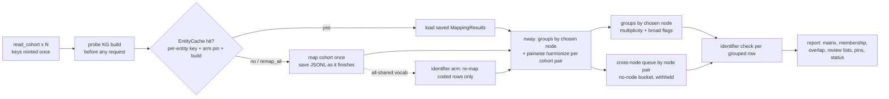

# feat: harmonize_many() for harmonizing more than two cohorts

## Overview

Add `harmonize_many()`, which harmonizes two or more cohort tables in one pinned run. It maps each cohort once and saves the result so later runs can reuse it. It groups rows across cohorts by the chosen KRAKEN node. Links that cross nodes, groups with more than one row from one cohort, groups on class-level ("broad") nodes, and submitter identifiers that are not confirmed all go to review lists. The function is built on the same reading, mapping and pin code that `harmonize_cohorts()` uses, without changing `harmonize_cohorts()` or `harmonize()`.

The first consumer is a five-cohort public metabolite demo (QMDiab, Columbia ST002484/2700/2711, CHEAR ST000825, Tartu ST005094, Broad CSF ST003788). That demo is a separate research run and not part of this plan.

## Problem Frame

See origin. The two-cohort functions can't be looped:
- **Cost:** they re-map both cohorts on every call.
- **No consistent groups:** pairwise links don't chain into groups.
- **Identifier rule:** "only vocabularies both cohorts declare" has no direct N-way equivalent.

The requirements fix:
- **Grouping:** anchored on the chosen node; links across nodes are review items.
- **Identifiers:** submitter IDs are a per-row check, plus an arm only for vocabularies all cohorts declare.
- **Run model:** resume and add cohorts, with strict reuse rules.
- **Existing numbers:** reconciliation per pair against `harmonize()`, with existing functions unchanged.

(see origin: docs/brainstorms/2026-11-03-harmonize-many-requirements.md)

**Target repo:** `biomapper` (the Python package). Branch from `origin/main` (v1.6.0, which includes `_pins.py`, `_checkpoint.py` and the MCP server), not from the stale `feat/harmonize-cohorts` working tree. Per routing, the PR goes to the personal fork first.

## Requirements Trace

- **R1–R2:** public `harmonize_many()`, two or more cohorts, same inputs as `harmonize_cohorts()`, one mapping per cohort per arm → Units 1, 4
- **R3–R6:** node-anchored groups, a cross-node review queue (same name-linking rules), the multiplicity flag, the broad-node flag (R5b), unresolved and errored rows listed → Unit 2
- **R7–R9:** names-only primary arm, an arm only for vocabularies every cohort declares, plus a group diff, and the offline identifier check → Units 3, 4
- **R10–R13, R12b:** saved mappings, a reuse key over request content, KG build read before mapping, unknown build means no reuse, engine fingerprint and session as provenance, publication grade (reuse = iteration-grade), lock, `remap_all`, reused-versus-fresh report → Unit 1
- **R14:** report object, saved by default, holding the matrix, membership, overlap matrix, review lists, per-cohort counts, run record and `summary()` → Unit 4
- **R15:** reconciliation per pair (same-node row pairs + cross-node links = `harmonize()` links) → Units 2, 4
- **Success criteria:**
  - reconciliation, no chaining, broad nodes, mapping-call counts, identifier-check statuses, scale fixture, demo run → Units 1–4 tests
  - **split-recall gate** (name-independent key, stratified) → Unit 5

## Scope Boundaries

- No engine (biomapper2) changes, no structure check, no merging across nodes, no roll-up, no fuzzy name matching (see origin).
- One entity type per run.
- `harmonize_cohorts()`, `harmonize()` and the `biomapper.harmonize` subpackage behave exactly as before. Their tests stay unchanged.
- Fetching or parsing the public datasets, scoring against answer keys, and difficulty tiers are not in this plan.

### Deferred to Separate Tasks

- **Five-cohort demo run:** a separate research run after this lands and after the split-recall gate is accepted.
- **Calling `harmonize_many()` from the MCP server:** a later PR, if wanted.
- **Opt-in API resolution of "not confirmed" codes** (to tell "contradicted" from "missing cross-reference"): a follow-up. v1 reports `not_confirmed` only (origin, deferred question).

## Context & Research

### Relevant Code and Patterns

- `src/biomapper/cohorts.py`:
  - **Reading and normalizing:** `read_cohort`, `Cohort`, `CohortRecord` (declared IDs in `identifiers`, normalized vocabularies) and `_table_rows`. Only file inputs get a checksum today.
  - **Mapping and pins:**
    - `classify_vocabularies` (two-way only).
    - `Mapper` protocol and `BatchedApiMapper` (batch 10, 300 s), and `_call_mapper`, which enforces one result per request.
    - `_collect_pins`, which today is called after mapping.
  - **Writing and checks:**
    - `_write_mapping` (TSV; not enough to rebuild a `MappingResult`).
    - `_new_run_dir` (exclusive mkdir plus `_N` suffix; the prefix is hardcoded).
    - `_require_cohort_labels` and `_safe`.
    - `NAME_LINKING_CATEGORIES`.
  - **Report:** `CohortHarmonizationReport` (`summary()`, `write()`, no absolute paths in JSON).
- `src/biomapper/harmonize/linking.py`:
  - `harmonize()` partitions each side and builds `curie_set(chosen, equivalents)`.
  - The `node` basis needs an intersection and the same raw `chosen_kg_id`.
  - Name links come from `name_matches` over resolved rows only, using `normalize_name` and `NAME_CASEFOLD_MIN_LENGTH_EXCLUSIVE = 4`.
  - Withheld pairs exclude pairs already linked by identifier.
  - `link_by_intersection` uses an inverted index.
- `src/biomapper/harmonize/curies.py`: `curie_set` (drops INCHIKEY/INCHI/SMILES), `canonical_prefix`, `normalize_curie`.
- `src/biomapper/models.py`:
  - `MappingResult` roundtrips through `model_dump(mode="json")` / `model_validate`.
  - The broad signal is `lipid_resolution.mapping_relation == "broad"`.
  - `identifiers` holds engine-assigned IDs and must not be used for R9.
- **Saved-mapping store and reuse policy, to mirror rather than reinvent:**
  - `src/biomapper/_checkpoint.py`: pandas-free fsynced JSONL, pin on the first line, `PIN_FIELDS`, `CachePinMismatch`, `CACHE_EXCLUDED_FIELDS`, errors never cached, a torn final line tolerated, atomic replace.
  - `src/biomapper/mcp/jobs.py`: pins probed before mapping, `_cache_pin`/`_pin_known` (unknown build never reused), `session_id = uuid4`, a build mismatch fails with a rerun instruction.
- `src/biomapper/_pins.py`: `collect_pins`, `kg_build_label`, `kg_verified`. `fetch_kg_build_info` never raises.
- **Tests:**
  - Cohort tests: `tests/cohorts_helpers.py` (`mr()`, `FakeMapper` with `calls`/`.sent`), `tests/test_cohorts_replay.py` (`ReplayMapper`), `tests/fixtures/cohorts_labs_cm/` (UK Biobank × Arivale labs at kg 2.3.0 / 3dd08a5b; 37 links, 21 one-to-one).
  - Import guard: `tests/test_cohorts_imports.py` (pandas-free import).
  - Dependency guard: `tests/test_packaging_extras.py::test_core_install_stays_light`.
- **Split-recall gate assets:**
  - `notebooks/data/monti_overlap/`: the Monti cross-cohort arm run `cross_cohort_20260927T180720Z` at kg 2.3.0 / 3dd08a5b, with manifest, `subset_expected.json` and certificate reports.
  - `src/biomapper/benchmarks/adapters/necs_metabolon.py`.
  - `src/biomapper/benchmarks/scorers/cross_cohort_overlap.py`.

### Institutional Learnings

- `docs/solutions/logic-errors/harmonize-cohorts-silent-key-and-output-collisions-2026-10-08.md` (untracked):
  - Every mapping onto a namespace must be injective: object identity, filename, dict key, run dir.
  - `model_copy` results from caching mappers.
  - Check labels pairwise after `_safe`.
  - Claim run directories exclusively.
- Vault `docs/solutions/logic-errors/keying-a-filtered-subset-renumbers-it-2026-09-23.md`: mint keys once over the original input, then partition. Check uniqueness across the union.
- `docs/solutions/logic-errors/benchmark-harness-reports-plausible-wrong-number-2026-09-23.md`:
  - Never join batch results by position without checking.
  - A run with a failed piece is `partial`, never `ok`.
- **Gated-decision note** (cache resumption):
  - Resume keys on durable artifacts and checks provenance first.
  - Filter one population everywhere.
- **Expensive-run artifacts:** results inside a gitignored worktree path were lost, so print the absolute saved path and allow a durable store location.
- **Hand-built fixture hid a prod bug:** prefer fixtures built from recorded real payloads, and run one live smoke check before release.
- **Absent evidence is unverifiable, not wrong:** record a versioned `comparison_rule` on the report.
- **Memory notes, not solution docs:**
  - Cold and warm runs disagree.
  - The noise floor is about 1 point.
  - Normalize legacy 5-digit HMDB IDs.
  - Sum-composition lipids are irreducible.

### External References

- None. Local patterns cover every layer.

## Key Technical Decisions

- **New module `src/biomapper/harmonize_many.py`.**
  - It imports reading, mapping and pin helpers from `cohorts.py` rather than copying them.
  - `cohorts.py` is already large, and the existing two-cohort module stays untouched apart from the small helper extractions in Unit 1.
  - The offline grouping core lives in `src/biomapper/harmonize/nway.py`, keeping the `biomapper.harmonize` contract of no network calls.
- **v1 links pairwise with `harmonize()`; groups come from the chosen node** (Trent, 2026-11-06, after plan review).
  - For each cohort pair, call the unchanged `harmonize(a, b, link_by_name=<category rule>, key=...)` on the saved results, passing the minted keys through `key` (no object-identity keying).
  - Groups are formed separately by raw `chosen_kg_id`. A pairwise link whose two rows are in the same group is a same-node pair; every other link is a cross-node link. `harmonize()`'s `name_match_withheld` is the withheld list.
  - So reconciliation (R15) holds by construction, and there is no second linking engine to keep equivalent.
  - Cost is N(N-1)/2 offline calls: 10 at five cohorts, 190 at twenty. Fine up to about 20 cohorts. The public API does not expose the linker, so a global index can replace the internals later if a larger consumer appears.
- **What can be grouped.** A row joins a group only when all three hold:
  - it is not errored;
  - its `curie_set` is non-empty;
  - its raw `chosen_kg_id` is not a structure namespace.

  Rows that have CURIEs but no usable chosen node go to a **no-node bucket**. Their identifier and name links still enter the cross-node queue, so R15 adds up. Rows with an empty `curie_set` are unresolved, using exactly the test `harmonize()` uses (resolves origin deferred question R3/R6).
- **Grouping key = the raw `chosen_kg_id` string**, the same as `harmonize()`'s `node` basis. Any normalization would break R15.
- **Cross-node queue aggregated by unordered node pair.** Each entry carries the bases, cohorts involved and row-pair count, and row pairs are kept as drill-down. Withheld short-name pairs are kept separately (resolves the origin's R4 deferred question).
- **Two counts per cohort pair, both reported:**
  - **Same-node row pairs:** per group, rows from cohort A × rows from cohort B.
  - **Overlap groups:** groups containing both A and B.

  The reconciliation identity uses row pairs (R15).
- **Broad-node flag** is `lipid_resolution.mapping_relation == "broad"` on any member row's result. One broad member is enough to flag the group (R5b).
- **Identifier check (R9) inputs:**
  - Declared IDs are `CohortRecord.identifiers`, built as `vocabulary:code`, normalized with `normalize_curie` and an explicit HMDB zero-pad step for legacy 5-digit codes.
  - They are compared with the row's `curie_set`.
  - Declared InChIKeys are compared, full key, against the node's `INCHIKEY` equivalents taken straight from `kg_equivalent_ids`, because `curie_set` drops structure namespaces.
  - Statuses: `confirmed`, `not_confirmed`, `no_declared_id`, `errored`.
  - The report records `comparison_rule` (versioned).
- **All-shared identifier arm (R8).**
  - A vocabulary is supplied only when every cohort declares it.
  - As in `harmonize_cohorts`, only rows that carry a shared code are re-mapped. All other rows reuse their names-only result.
  - The arm's saved mapping records that it depends on the names-only entry, so invalidating one invalidates the other.
  - Diff: groups only in names-only, only in the identifier arm, or in both, keyed by node.
- **The saved-mapping store is the existing `_checkpoint.EntityCache`** (Trent, 2026-11-06, after plan review).
  - One `EntityCache` per arm under `store_dir`, with the pin from `mcp/jobs.py`'s `_cache_pin` plus the arm. Entries are keyed per entity by `cache_key(name, vocabulary, identifiers, options)`, so two analyses that both use the label "QMDiab" can't collide, and partial reuse (a torn tail, re-sending only errored rows) falls out of per-entity keys.
  - **Exclusive lock:** a lockfile created with O_EXCL beside each cache. A second run that finds the lock held refuses with a clear message rather than writing concurrently.
  - **Per-cohort provenance:** a small JSON per cohort per run records the session id (uuid4), the request checksum, the file sha256 where there is one, and which entities were reused versus freshly mapped (R13).
  - Identifier-arm entries are keyed by the identifiers actually sent, so adding a cohort that shrinks the shared-vocabulary set simply produces different keys. Rows are re-mapped only under the new set; there is no cross-entry dependency to track.
- **Request checksum** (a sha256 over the canonical JSON of the ordered key, name and sent identifiers per row, the column declarations, category, annotation mode and arm, computed the same way for every input kind) is recorded as provenance, not as the reuse key.
- **KG build read before any request.**
  - An injectable seam for offline fixtures, e.g. a `kg_build=` override or `mapper.pins`, so tests can exercise reuse and refusal.
  - When the build is unknown, saved mappings are not reused. The run maps fresh and says why.
  - A mismatch is refused before any request, naming the cohorts and pointing to `remap_all=True`.
- **Store location:** the default is `<runs root>/harmonize_many_store/`, beside timestamped run directories under `biomapper_runs/`, with a `store_dir=` override. Run directories are claimed exclusively with the prefix `harmonize_many_`. The run prints the absolute store and run paths.
- **Run status** is one of `ok`, `partial` (some cohort's mapping had errored rows or failed) or `failed`. It is shown in `summary()` and `write()`.
- **Publication grade** (Trent, 2026-11-06, after plan review): a run that reused any saved mapping is labelled `iteration-grade, not for publication`. Only a `remap_all` run can be `publishable`. The API exposes no engine fingerprint beyond a stale self-reported version, so reuse can't detect drift on the same build. Session ids are kept as provenance; there is no mixed-session flag pretending to detect drift.

## Open Questions

### Resolved During Planning

- **Reuse store format:** `_checkpoint.EntityCache` (per-entity JSONL). Declared IDs are not part of the mapping request in the names-only arm, so they are saved in the per-run membership output and re-read from the cohort table, not from the cache. The TSV is kept only as a human-readable export.
- **R9 structure vocabularies and legacy codes:** a separate InChIKey comparison against `kg_equivalent_ids`, and zero-padding of HMDB.
- **Refactor mapping out of `harmonize_cohorts()`:** extract only pure helpers it already contains (request checksum, a parameterized run-directory prefix, pin-before-mapping helper) behind its unchanged behaviour. Its own tests are the guard.
- **Engine fingerprint:** the API exposes only its self-reported version. The pin records two fields, as `_pins.collect_pins` already does: the API's self-reported version, labelled "self-reported, known stale", and `engine_release: "unavailable"`. Drift on the same build is handled by the publication grade, not detected.
- **Matrix format:** long format (membership TSV) is authoritative. A dense entity × cohort TSV is also written, since it is small at the target sizes (≈1,000 groups × up to 20 columns).
- **Split-recall run mode:** the repo ships counts and provenance only for the Monti arm (`notebooks/data/monti_overlap/ARTIFACTS.json`), so the gate needs a fresh, operator-started live run at the current build, with the build recorded. The NECS MOESM5 file is supplied by path and checked against its recorded sha256; the Arivale panel ships at `notebooks/data/ukbb_arivale/panels/`.
- **Split-recall answer key:** identifier agreement between NECS gold and Arivale's declared IDs, screened to certifiable rows, reported by name-equal and different-name strata (see Unit 5).

### Deferred to Implementation

- **Exact field names** on the report and on store pin lines. These are decided while writing tests.
- **Scale budget:** the time budget for the 20 × 1,000 synthetic fixture, set from a first timing.

## High-Level Technical Design

> *This illustrates the intended approach and is directional guidance for review, not implementation specification. The implementing agent should treat it as context, not code to reproduce.*

## Implementation Units

- [ ] **Unit 1: Saved-mapping store on EntityCache, lock, provenance, and pin-before-mapping**

**Goal:** Map each entity at most once per arm across runs, reuse safely, and refuse concurrent writers.

**Requirements:** R2, R10, R11, R12, R12b (as amended), R13

**Dependencies:** None

**Files:**
- Create: `src/biomapper/_mapping_store.py` (a thin wrapper: lock, per-arm `EntityCache`, per-cohort provenance, pin-before-mapping)
- Modify: `src/biomapper/cohorts.py` (extract a parameterized run-directory prefix and a request-checksum helper; no behaviour change)
- Test: `tests/test_mapping_store.py`

**Approach:**
- The pin is probed before any request, with an injectable build override for fixtures. An unknown build disables reuse. A known mismatch raises `CachePinMismatch`-style before any request, naming the arm and suggesting `remap_all`.
- A cache miss is mapped through the `Mapper` and written to the cache as each batch finishes; errored results are never cached.
- A cache hit is `model_copy`'d on load (as `EntityCache` already does).
- An O_EXCL lockfile guards each cache; it is removed on clean exit, and a stale lock is reported with its owner's pid and start time rather than silently broken.
- Each run writes per-cohort provenance: session id, request checksum, file sha256, reused and fresh entity counts.

**Patterns to follow:** `src/biomapper/_checkpoint.py` (`EntityCache`, `cache_key`, `PIN_FIELDS`, `CachePinMismatch`), `src/biomapper/mcp/jobs.py` (`_cache_pin`, `_pin_known`, session id), `src/biomapper/_pins.py`.

**Test scenarios:**
- **Happy path:** a fresh store with three cohorts → every entity mapped once. A second run with identical inputs and build → zero mapper calls, all entities reported as reused, and the run is `iteration-grade`.
- **Happy path:** adding a fourth cohort → only entities not already cached are mapped (`FakeMapper.calls` grows only by the new cohort's unseen names).
- **Edge case:** two analyses label different tables "QMDiab" → no collision; each entity resolves from its own key.
- **Edge case:** a torn last line in the cache → entries load up to the last complete line, and the missing entities are re-mapped.
- **Edge case:** adding a cohort that does not declare HMDB shrinks the shared-vocabulary set → the identifier arm's requests change; rows are mapped only under the new set, or the arm is skipped when the set is empty.
- **Error path:**
  - Build unknown → no reuse, fresh mapping, and the reason is recorded.
  - Saved build ≠ current build → refused before any request.
  - `remap_all=True` → every entity re-mapped despite hits, and the run can be `publishable`.
  - Lock held by another run → refused with a message naming the holder.
- **Error path:** errored rows are never cached; only those rows are re-sent on the next run.
- **Integration:** a caching mapper returning one shared object for two rows → distinct copies are stored and keys don't collapse.

**Verification:** Mapper call counts in the fixtures match "each entity once per arm". Existing `tests/test_cohorts_*.py` pass unchanged.

---

- [ ] **Unit 2: Offline N-way grouping core**

**Goal:** From already-mapped results for N cohorts, build node-anchored groups, flags, the cross-node queue, the no-node bucket, withheld pairs and per-pair counts, with no network calls.

**Requirements:** R3, R4, R5, R5b, R6, R15

**Dependencies:** None (pure; uses `harmonize/curies.py` and `linking.py` helpers)

**Files:**
- Create: `src/biomapper/harmonize/nway.py`
- Modify: `src/biomapper/harmonize/__init__.py` (export the N-way result types only if this does not change existing exports; otherwise keep them internal)
- Test: `tests/test_harmonize_nway.py`

**Approach:**
- Row identity is (cohort label, record key) everywhere: indexes, membership and drill-down. Keys are minted once per cohort and checked for uniqueness within each cohort across all buckets. Default keys such as `0|glucose` repeat across cohorts, so uniqueness is never checked on bare keys across cohorts.
- `nway` takes `link_by_name: bool` and already-validated labels as parameters. It does not import `cohorts.py`; the category check and `_safe` label validation stay in `harmonize_many.py`, keeping `biomapper.harmonize` free of network code and circular imports.
- One pass computes `curie_set` per row (the same test `harmonize()` uses). Rows are then sorted into four buckets:
  - errored
  - unresolved (empty set)
  - no-node (CURIEs but no usable chosen node)
  - groupable
- **Groups:** keyed by raw `chosen_kg_id`.
  - **Clean:** each present cohort contributes exactly one row.
  - **Multiplicity flag:** some cohort contributes two or more rows.
  - **Broad flag:** any member has `mapping_relation == "broad"`.
- **Cross-node evidence:** from one `harmonize()` call per cohort pair. Links between rows in different groups, or touching a no-node row (placed under a sentinel node key), go to the cross-node queue, aggregated by node pair. Drill-down row pairs are streamed to a TSV, and only aggregates are kept in memory.
- Per cohort pair, it computes three things: same-node row pairs, cross-node link pairs and overlap groups.
- Labels must be distinct after `_safe` across all N.

**Execution note:** Write the reconciliation test first. With pairwise linking it should hold by construction; the test guards the bucket and group bookkeeping.

**Patterns to follow:** `harmonize/linking.py` (`harmonize`, its `key` argument, `_partition_side`).

**Test scenarios:**
- **Happy path:** three cohorts each with glucose on one node → one clean group with three members, and overlap 1 for every pair.
- **Edge case (multiplicity):** cohort A has two rows on one node → the group is flagged, not clean, and still returned.
- **Edge case (broad):** species rows from three cohorts resolve to one class node with `mapping_relation="broad"` → a broad-node group that is not clean.
- **Edge case (no chaining):** a class node carries identifier and name links to five species nodes → no merged group, and the cross-node queue lists five node-pair entries with drill-down row pairs.
- **Edge case (no-node):** a row with CURIEs but a structure-namespace `chosen_kg_id` → in the no-node bucket, not grouped. Its identifier link to another cohort's row appears in the cross-node queue.
- **Edge case (casefold withholding):** `Co` vs `CO` → withheld, not a cross-node link.
- **Edge case:** name links are off for `biolink:ClinicalMeasurement`.
- **Edge case:** the same default key `0|glucose` in three cohorts → no error; rows stay distinct by (cohort, key).
- **Error path:**
  - Duplicate keys within one cohort → raises before grouping.
  - Labels colliding after `_safe` → raises.
- **Integration (R15):** for every pair in the UK Biobank × Arivale metabolites replay (name linking on), the proteins replay, the labs replay and a synthetic three-cohort fixture, same-node row pairs + cross-node link pairs = the number of links from `harmonize(a, b, link_by_name=<rule>)` on the same results.
- **Scale:** 20 synthetic cohorts × 1,000 rows (190 pairwise calls) link offline within a budget set from a first timing. Drill-down pairs are streamed, not held.

**Verification:** The reconciliation identity holds on every fixture pair. Existing `tests/test_harmonize_*.py` are unchanged and pass.

---

- [ ] **Unit 3: Identifier check (offline)**

**Goal:** For every grouped row in the names-only arm, compare submitter-declared IDs with the chosen node's identifiers and assign a status. In the identifier arm the same codes were sent to the mapper, so statuses there are labelled "ID supplied to mapper, not independent" and kept out of headline confirmation counts.

**Requirements:** R9

**Dependencies:** Unit 2 (grouped rows); `CohortRecord.identifiers` from `read_cohort`

**Files:**
- Modify: `src/biomapper/harmonize/nway.py` (or a small sibling `src/biomapper/harmonize/idcheck.py`)
- Test: `tests/test_harmonize_idcheck.py`

**Approach:**
- Declared `vocabulary:code` pairs are normalized with `normalize_curie` (from `harmonize/curies.py`, not the pandas-importing benchmarks copy), plus a pandas-free HMDB zero-pad helper added to `harmonize/curies.py`. A code that already starts with `<vocab>:` (case-insensitive) is used as-is, so `CHEBI:15422` under CHEBI does not become `CHEBI:CHEBI:15422`. A vocabulary label that does not normalize to a KG prefix (e.g. `PUBCHEM CID`) gives `no_declared_id` with the reason recorded, not `not_confirmed`.
- They are compared with the row's `curie_set`. Declared InChIKeys are compared against `kg_equivalent_ids["INCHIKEY"]`.
- Statuses: `confirmed`, `not_confirmed`, `no_declared_id`, `errored`.
- Only `not_confirmed` rows go to the review list. Statuses also appear as a column in the membership output.
- A `comparison_rule` version string is recorded.
- The report text says that `not_confirmed` does not mean contradicted.

**Test scenarios:**
- **Happy path:** a declared `HMDB:HMDB0000122` that is among the node equivalents → `confirmed`.
- **Edge case:** a legacy `HMDB00122` → normalized → `confirmed`.
- **Edge case:** `KEGG.COMPOUND:C00031` vs a node `KEGG:C00031` → `confirmed`.
- **Edge case:** a declared InChIKey equal to the node's INCHIKEY equivalent → `confirmed`. A different InChIKey → `not_confirmed`.
- **Edge case:** a row with no declared IDs → `no_declared_id`. An errored row → `errored`.
- **Edge case:** a cell `CHEBI:15422` under vocabulary CHEBI → `confirmed` when CHEBI:15422 is an equivalent. Vocabulary label `PubChem CID` → `no_declared_id`, reason "unmappable vocabulary".
- **Error path:** a declared ID that is present but absent from the equivalents → `not_confirmed` and listed for review.
- **Integration:** the check never reads `MappingResult.identifiers`. A fixture where only the engine-assigned IDs match the declared ones still gives `not_confirmed`.

**Verification:** Statuses match on all fixtures, and the review list contains only `not_confirmed`.

---

- [ ] **Unit 4: `harmonize_many()` orchestration, identifier arm, and report**

**Goal:** The public call that ties reading, the store, mapping, grouping and checks into one pinned, saved-by-default report.

**Requirements:** R1, R2, R7, R8, R14, R15; Success criteria (reconciliation, demo-ready run)

**Dependencies:** Units 1–3

**Files:**
- Create: `src/biomapper/harmonize_many.py` (function and report class)
- Modify: `src/biomapper/__init__.py` (export `harmonize_many` and its report), `src/biomapper/cohorts.py` (`__all__` untouched unless helpers move)
- Test: `tests/test_harmonize_many.py`, `tests/test_harmonize_many_report.py`, `tests/fixtures/harmonize_many_small_molecule/` (a three-cohort small-molecule replay fixture built from recorded real payloads)

**Approach:**
- **Inputs:** a mapping of label → cohort table, plus per-cohort name column, vocabularies and key column, as in `harmonize_cohorts`. Also entity, category override, request policy, mapper seam, pins seam, `store_dir`, `output_dir`, `save`, `remap_all` and `progress`.
- **Primary arm:** names only, mapped through the Unit 1 store.
- **Identifier arm:** vocabularies declared by every cohort. Only coded rows are re-mapped. A group-level diff against names-only. When nothing is shared, the arm is skipped with the reason recorded.
- **Report (`summary()` JSON-safe, `write()` with no absolute paths in JSON):**
  - membership (long format)
  - dense matrix
  - overlap matrix
  - cross-node queue (node-pair level and drill-down)
  - flagged and broad groups
  - identifier-check review list
  - unresolved, errored and no-node lists per cohort
  - per-cohort counts
  - per-pair reconciliation table
  - settings, pins and run status
- Each arm is written as soon as it completes.

**Execution note:** Start with an end-to-end test over the small-molecule replay fixture asserting the report's counts and the per-pair reconciliation.

**Patterns to follow:** `harmonize_cohorts()` and `CohortHarmonizationReport` in `src/biomapper/cohorts.py`; `tests/test_cohorts_replay.py` (`ReplayMapper`).

**Test scenarios:**
- **Happy path:** three cohorts from the small-molecule replay → status `ok`. Membership, matrix and overlap agree with one another. Every pair reconciles with `harmonize()`.
- **Happy path:** two cohorts (labs replay) → it runs (N=2 allowed). Pairwise reconciliation covers identifier links only, because name linking is off for labs. `harmonize_cohorts` numbers are unchanged.
- **Edge case:** all three cohorts declare HMDB → the identifier arm runs and re-maps only coded rows, and the diff is reported. Two of three declare HMDB → the arm is skipped with the reason.
- **Edge case:** one cohort's mapping has errored rows → status `partial`, and the errored rows are listed.
- **Error path:** fewer than two cohorts, duplicate labels, a reserved label, an unknown entity, or a bad column → `ValueError` before any request.
- **Error path:** a build mismatch with the saved mappings → refused before any request (from Unit 1, exercised through the public call).
- **Integration:** `save=True` by default writes all outputs to a fresh `harmonize_many_<stamp>` directory and prints the absolute path. Two runs in the same second get distinct directories.
- **Integration:** `import biomapper` and `biomapper.harmonize_many` work without pandas (extend the import guard), and the core dependency set is unchanged.

**Verification:** The public call works end to end on the replay fixtures. The existing test suite and `mypy --strict`/`ruff` pass, and the coverage gate holds.

---

- [ ] **Unit 5: Split-recall gate**

**Goal:** Measure, on an existing answer key, the share of true cross-cohort matches that land in a node group, in the cross-node queue, or in neither, before the demo builds on `harmonize_many()`.

**Requirements:** Success criterion "Split recall (gate)"

**Dependencies:** Unit 4

**Files:**
- Create: `scripts/harmonize_many_split_recall.py` (saves results by default to a timestamped directory, with pins and the answer-key checksum)
- Test: `tests/test_split_recall_script.py` (offline, on a small replay subset with a planted answer key)

**Approach:**
- **Answer key, independent of names** (Trent, 2026-11-06, after plan review): a true pair is a NECS row and an Arivale row whose identifiers agree, using NECS's curated InChIKey/HMDB (MOESM5) against Arivale's declared HMDB/InChIKey (`notebooks/data/ukbb_arivale/panels/`). Monti publishes only overlap counts, and its pairs come from a name match, which would make the gate pass by construction.
- NECS gold has about 5% InChIKey errors, so the key is screened to certifiable rows first, reusing the screening in `src/biomapper/benchmarks/adapters/necs_metabolon.py` where it applies.
- Runs through `harmonize_many()` on the two cohorts, names only.
- Each true pair is classified `same_group`, `cross_node_queue` or `neither`, and reported in **two strata**: name-equal pairs and different-name pairs. Only the different-name stratum counts as evidence about split risk.
- It is a pinned live run that the operator starts, at whatever build prod serves, with that build recorded. The MOESM5 path is supplied and checked against its recorded sha256.
- It records the KG build, package version, run status and publication grade (the gate run uses `remap_all`).
- The output is numbers for Trent to accept, not a pass/fail threshold baked in.

**Test scenarios:**
- **Happy path:** a planted key with three true pairs (one same-node, one cross-node by identifier, one unlinked) → counts 1/1/1.
- **Edge case:** a true pair with identical names and one with different names → each lands in its own stratum, and only the different-name stratum is labelled as split evidence.
- **Edge case:** a NECS row whose gold InChIKey fails screening → excluded from the key and counted as screened out.
- **Error path:** a key that names a row absent from the panel → listed as `missing_from_panel`, not counted in the shares.
- **Integration:** results are saved by default, and the printed path exists.

**Verification:** The script runs offline on the fixture. The live or replay run's numbers are reported to Trent with their pins, and Trent's acceptance is recorded before the demo starts.

---

- [ ] **Unit 6: Docs and changelog**

**Goal:** Document the call and its review outputs, especially how its strict counts relate to `harmonize_cohorts()`.

**Requirements:** R14, R15 (explaining the reconciliation)

**Dependencies:** Unit 4

**Files:**
- Modify: `README.md` (a new section after "Harmonizing two cohorts in one call"), `CHANGELOG.md` (`[Unreleased]`)
- Test: `tests/test_harmonize_public_api.py`, extended with the new export if that file asserts the export list

**Approach:**
- A short worked example on three toy cohorts.
- Explain each review list.
- Explain that `harmonize_many` counts are stricter than pairwise link counts, and how the reconciliation table connects them.
- Cover reuse and `remap_all`, and state that published numbers should come from a `remap_all` run.

**Test expectation:** export list assertion only. Otherwise none (docs).

**Verification:** The README example runs against `FakeMapper` in a doctest-style test, or is clearly marked illustrative.

## System-Wide Impact

- **Interaction graph:** new public export in `biomapper/__init__.py`; a new offline module under `biomapper.harmonize`; small helper extractions in `cohorts.py`. The MCP server is untouched.
- **Error propagation:**
  - Input validation raises `ValueError` before any request.
  - A store build mismatch raises before any request.
  - Mapping errors become per-row errored results and a `partial` status, never silent drops.
- **State lifecycle risks:**
  - The store persists across runs, so torn writes, a stale build, concurrent writers and cache drift all matter. These are covered by the pin line, unknown-build means no reuse, the lock, per-entity keys, and the publication grade with `remap_all`.
  - Errored rows are never reused.
- **API surface parity:** `harmonize_cohorts()` keeps its behaviour and outputs. `harmonize()` is unchanged.
- **Integration coverage:**
  - Reconciliation against `harmonize()` on real replay payloads.
  - Mapper call counts across resume and add-cohort.
  - The pandas-free import.
- **Unchanged invariants:**
  - Core dependencies remain httpx, pydantic and python-dotenv.
  - `biomapper.harmonize` makes no network calls.
  - Existing tests are unchanged.
  - Already-reported milestone numbers stay valid.

## Risks & Dependencies

| Risk | Mitigation |
|------|------------|
| Strict grouping splits true matches (stereo, salt, charge variants on different nodes), making the review queue the real output | Unit 5 gate measures the split on a name-independent key, different-name stratum, before the demo; Trent accepts the number |
| Concurrent runs write one store | O_EXCL lock per cache; a second writer is refused |
| A pairwise linker is too slow above about 20 cohorts | Internals are not part of the public API; swap in a global index when a larger consumer exists |
| Reconciliation identity breaks on edge rows (no-node, structure-namespace chosen IDs, withheld names) | Explicit buckets and a test-first reconciliation in Unit 2 on two fixtures |
| Cache or engine drift on one build changes the chosen node, and reuse can't detect it | Any run with reuse is `iteration-grade, not for publication`; only `remap_all` runs are publishable |
| Hand-built fixtures hide prod payload shapes | Small-molecule fixture built from recorded real payloads; one live smoke run before release |
| Small-molecule reconciliation needs real payloads | The UK Biobank × Arivale metabolites replay already ships (`notebooks/data/ukbb_arivale/replay/metabolites_replay.json.gz`, sha-pinned, name linking on) and the proteins replay is a second entity; both are used now. Only the three-cohort end-to-end fixture needs an operator recording |
| Store directory inside a worktree is lost on cleanup | Absolute paths printed; `store_dir` override documented |

## Documentation / Operational Notes

- The README gets a section; the CHANGELOG gets an Unreleased entry. Releasing to PyPI stays the manual chain, Trent's call.
- Greptile: this PR carries real logic, so it is worth a review. Open it on the personal fork first per routing.

## Sources & References

- **Origin document:** [docs/brainstorms/2026-11-03-harmonize-many-requirements.md](../brainstorms/2026-11-03-harmonize-many-requirements.md)
- **Related plan:** `docs/plans/2026-10-08-001-feat-harmonize-cohorts-plan.md`
- **Related code:**
  - `src/biomapper/cohorts.py`, `src/biomapper/harmonize/linking.py`, `src/biomapper/harmonize/curies.py`, `src/biomapper/models.py`
  - `src/biomapper/_checkpoint.py`, `src/biomapper/mcp/jobs.py`, `src/biomapper/_pins.py`
- **Split-recall assets:** `notebooks/data/monti_overlap/`, `src/biomapper/benchmarks/adapters/necs_metabolon.py`
