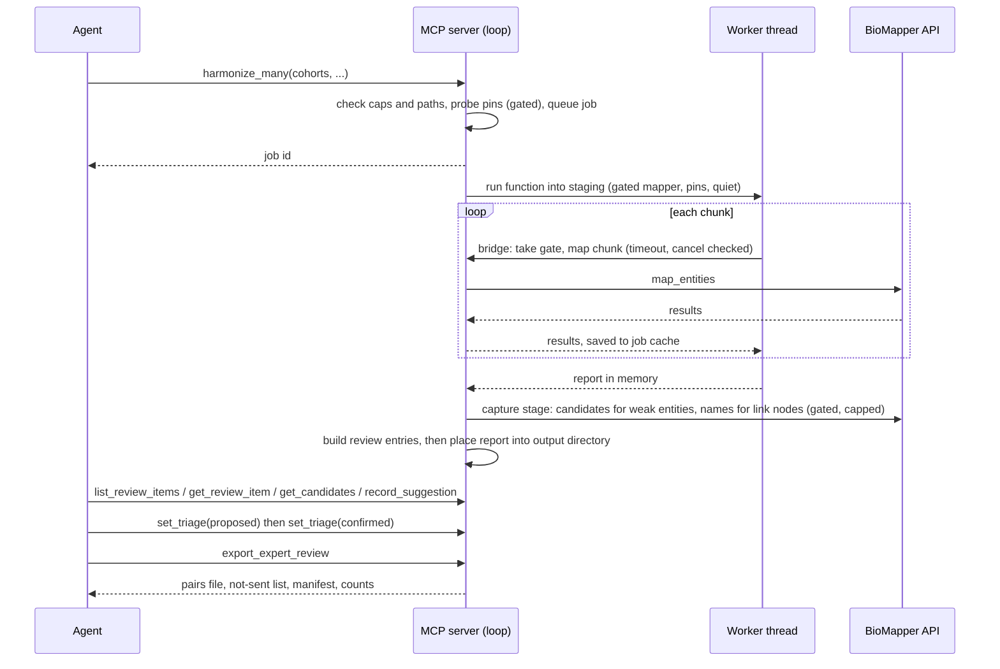

# feat: Harmonization and review triage through the MCP server

## Overview

Two phases, each a separate pull request and each useful alone.

- **Phase 1** makes `harmonize_cohorts()` and `harmonize_many()` runnable as background jobs
  through the MCP server, and turns what they flag into one list of review items that an agent can
  read, get evidence for, and record a suggestion on.
- **Phase 2** adds a triage status per review item (send to experts, settled, left as is), and an
  export of the "send to experts" items as a pairs file that uploads to an Expert-in-the-Loop
  campaign with no hand reshaping.

Phase 3 of the origin document (the reviewed table, R14 to R18) is not planned here.

## Execution Scope For This Run

**Build Phase 1 only: Units 1 to 5, plus the node-name check from Unit 0.** Do not build Units 6
to 8, and do not create `triage.py` or `expert_export.py`. The Expert-in-the-Loop upload check in
Unit 0 and all of Phase 2 are a later run (Trent, 2026-11-11). Add this plan and its origin
requirements document to the branch so they travel with the pull request. The Unit 5 live check
against the production service is the operator's step after merge review, not part of the
automated run; build and test offline.

## Problem Frame

A researcher harmonizing cohorts through an agent cannot run harmonization at all over MCP today,
and nothing turns a review list into something experts can work through. The goal is for the
researcher, helped by their agent, to decide which subset needs expert review and hand that subset
to an Expert-in-the-Loop campaign they organize. Blind expert judgment happens there, not in the
MCP server (see origin: `docs/brainstorms/2026-11-11-mcp-user-decision-review-requirements.md`).

## Requirements Trace

Phase 1:
- R1. Two-cohort and many-cohort harmonization as background jobs: submit, status, resume, cancel.
- R2. The job writes the Python API's report and returns a compact summary; review lists are read
  on demand.
- R3. Many-cohort jobs reuse saved mappings under the 1.8.0 rules.
- R4. One typed list of review items with server-issued references: row items and link items.
- R5. Items listed by impact, largest first.
- R6. Evidence on demand for row items (candidates) and link items (both sides together).
- R7. Agent suggestions with a rationale, including "same", "different", "cannot tell" for links.
- R19 (Phase 1 part). Tool descriptions guide the agent's role for the Phase 1 tools.
- R20. Text from the knowledge graph, cohort files or the agent is capped and stripped.
- R21. Evidence fetching counts against existing protections.

Phase 2:
- R8. Triage status per item; the agent proposes in bulk, the researcher approves.
- R9. Recorded through the agent on the researcher's say-so, and marked as relayed by the agent.
- R10. Triage saved to a plain file next to the run's output. (Reading an edited file back in is
  deferred; see Scope Boundaries.)
- R11. Export of "send to experts" items as an Expert-in-the-Loop pairs file; each pair traces to
  its review item.
- R12. The export states which fields it fills; agent suggestions are left out.
- R13. Every review tool result states the triage counts.
- R19 (Phase 2 part). Guidance for triage and export.
- R22. Triage and export also work for weak rows from file mapping. (Narrowed from the origin;
  see Scope Boundaries.)

Success criteria carried from the origin: engine-only outputs identical with and without the
feature; a real exported file uploads to Expert-in-the-Loop and shows as reviewable pairs; every
exported pair traces back to a review item.

## Scope Boundaries

- No reviewed table and no recording of the researcher's own answers (origin R14 to R18). In
  Phase 2 "settled" records the status and a reason only.
- No server prompts (MCP elicitation), no blind or anchored modes, no label export.
- No push to Expert-in-the-Loop over its API, and no import of campaign results.
- No change to the engine, and no LLM call in the client or server.
- Not review items in v1, all left as report files:
  - within-node multiplicity groups, broad-node groups, identifier-check "not confirmed" rows;
  - two-cohort `possible_missed` and `review_queue` entries. These are single rows and one-sided
    code checks, not links between two rows, so they do not fit either item kind;
  - many-cohort cross-node entries where a side is `NO_NODE`.
- Review items come from the names-only arm only.
- **Narrowed from the origin (approved by Trent, 2026-11-11):**
  - R10: the triage file is written, and the job's own record stays authoritative. Reading a
    hand-edited file back in is deferred to the replay work in Phase 3.
  - R22: triage and export cover file-mapping jobs. References from single-entity and batch calls
    belong to no run and have no output location, so they keep 1.7.0 behaviour (candidates and
    suggestions) and are not triaged or exported in v1.

### Deferred to Separate Tasks

- Reviewed table, replay and read-back of a triage file (origin Phase 3): a follow-on plan.
- Returning campaign results to BioMapper, and feeding expert-reviewed data to Kestrel and KRAKEN
  queries (steps 2 and 3 of the larger loop): future work. This plan's obligation to them is the
  stable pair ids and the manifest in Unit 7.
- A core change that would let an interrupted `remap_all` run keep its `publishable` grade.
- PyPI release, org sync and MCP registry publish: Trent's, after each phase merges.

## Context & Research

### Relevant Code and Patterns

- `src/biomapper/mcp/server.py`: `build_server()`, `_register_job_tools()`, `AppState`,
  `_gated()` and `_gated_partial()`, `_forbid_extra_arguments()`, `_load_ref()`.
- `src/biomapper/mcp/jobs.py`: `Job`, `JobManager`, `JobLock`, `_job_id`, `allowed_roots()`,
  `_resolve_input`, `_resolve_output`, `_create_exclusive`, `_place_without_overwrite`,
  `_write_final`, `_write_weak`, `write_choices`, `check_choices_writable`, `auto_resume`.
- `src/biomapper/mcp/references.py`: `RefRecord`, `RefStore`, `parse_ref`, the `ref-` and `jref-`
  formats (job refs live at `<home>/jobs/<job_id>/refs/`).
- `src/biomapper/mcp/candidates.py` (`verify`, `compact`, `sanitize`) and
  `src/biomapper/mcp/judgments.py` (`validate_choice`, `SuggestionStore`).
- `src/biomapper/mcp/gate.py`: `RequestGate` (an `asyncio.Lock` bound to the server loop),
  `CandidateBudget` (15 per 300 s), `LoopGuard`.
- `src/biomapper/mcp/_storage.py`: `private_dir` (0700), `write_private` (0600, atomic).
- `src/biomapper/mcp/tools.py`: `weak_trigger`, `SERVER_INSTRUCTIONS`, tool descriptions.
- `src/biomapper/cohorts.py`: `harmonize_cohorts`, `Mapper`, `BatchedApiMapper`,
  `CohortHarmonizationReport` (its existing `ReviewItem` class is the one-sided code check).
- `src/biomapper/many_cohorts.py`: `harmonize_many`, `ManyCohortReport`, `ArmReport`, the
  `isinstance(the_mapper, BatchedApiMapper)` custom-mapper test, `publication_grade`.
- `src/biomapper/harmonize/linking.py` (`Link`, `review_reasons`, `review_links`) and
  `src/biomapper/harmonize/nway.py` (`CrossNodeEntry`, `RowPair`, `NO_NODE`, `group_cohorts`).
- `src/biomapper/_mapping_store.py`: `MappingStore`, `map_requests`, `store.lock`, `_supersede`.
- Tests: `tests/mcp_server/` (in-memory client, `mcp_helpers.py`, `respx`),
  `tests/test_harmonize_many.py`, the two-cohort modules `tests/test_cohorts_*.py`,
  `tests/cohorts_helpers.py`, `tests/nway_helpers.py`,
  `tests/mcp_server/test_packaging_mcp.py` (tool names over real stdio).

### Facts about the core functions that shape this plan

- Both functions are synchronous, and the default mapper uses `asyncio.run`.
- Both print to stdout, which the stdio transport owns.
- Both write straight into `output_dir` as each arm completes, with plain writes that follow
  symlinks and overwrite.
- `harmonize_many` resumes only through its store. With an unknown KG build the store saves
  nothing. With `remap_all` the store moves existing entries aside before mapping.
- `map_requests` calls the mapper once per chunk and never re-sends errored rows.
- The saved mapping files carry no certificate or status.
- `MappingResult` has the chosen node's id and equivalent ids, and no node name.
- Each streamed drill-down `RowPair` keeps its nodes in cohort order, while a `CrossNodeEntry` is
  keyed by the sorted node pair.

### Institutional Learnings

- `docs/solutions/best-practices/mcp-server-file-jobs-review-gap-2026-11-03.md`: the `map_file`
  job code passed internal review and then drew six P1s from Greptile: cancel overwritten after an
  await; rerun deleting under a live worker; an exception escaping the worker and killing the
  server; resume re-checking only one path against roots; partial files following symlinks; a
  health probe outside the gate.
- `docs/solutions/best-practices/mcp-registry-pypi-launch-contract-2026-11-04.md`: registry
  clients launch `uvx biomapper==<version>` with no extras.
- `docs/solutions/logic-errors/benchmark-harness-reports-plausible-wrong-number-2026-09-23.md`: a
  partly mapped cohort must be marked partial; a reordered batch is fatal.
- From the vault's solutions: keys come from the original input row, never a filtered
  enumeration; an errored entity is never stored as unresolved; work is keyed on its identity, not
  a timestamp; path checks use the real path against the roots; run artifacts are kept outside a
  worktree.

### External References

- Expert-in-the-Loop import contract, read from `origin/main` at 792b088 (2026-07-30) of the
  `expert-in-the-loop` repository. **Read from code, never run.** Unit 0 runs it.
  - the upload wizard accepts `.csv` and `.tsv`, parsed in the browser by a simple parser: no
    newlines inside cells, no UTF-8 BOM, doubled quotes for escaping;
  - a file with the headers `source_text`, `source_id`, `source_dataset`, `target_text`,
    `target_id`, `target_dataset`, `pair_type` imports with no manual column mapping;
  - other columns are ignored unless the admin ticks them as metadata;
  - rows whose `source_id::target_id` already exists in the campaign are skipped;
  - `llm_confidence`, `llm_model` and `llm_reasoning`, when present, are shown to reviewers and
    cannot be hidden per campaign; ids and dataset names are shown too;
  - the results export carries `source_id`, `target_id` and aggregate votes, no metadata, and
    prefixes a cell starting with `=`, `+`, `-` or `@` with a quote mark;
  - upload is by an admin in the web interface only.

## Key Technical Decisions

**Running the functions as jobs**

- **Worker thread.** A harmonize job calls the existing function through
  `anyio.to_thread.run_sync`.
- **Gate through a `BatchedApiMapper` subclass.** The subclass bridges to the server loop per
  chunk, holds `RequestGate`, and calls the job client. As a subclass it is not classed as a
  custom mapper, so the saved-mapping store is used as in the Python API (R3). The job passes the
  server's configured base URL so the store's pins match a Python API run on the same store.
- **Bounded bridge.** Every bridge call has a timeout, checks the cancel flag and a shutdown
  flag, and fails the job on timeout. On server shutdown the job is cancelled and the server waits
  for the thread to leave its current chunk; the thread is not abandoned, so it cannot keep the
  store lock after the job lock is released.
- **Staging directory.** The function runs with its output directory set to a private staging
  directory inside the job's home directory. Only when the run, candidate capture and review
  entries are all complete are the report files placed into the researcher's output directory,
  with the existing no-overwrite, no-symlink helpers, as `_write_final` does for `map_file`. The
  researcher's directory is touched once. Resume re-runs into staging.
- **Two default-preserving changes to the core functions.** A keyword to route stdout messages
  elsewhere, and `pins=` on `harmonize_cohorts`. Redirecting `sys.stdout` was rejected: it is
  process-wide and would race the transport.
- **Resume does not depend on the store.** The mapper subclass keeps an entity cache in the job
  directory for both job kinds, under the same KG-build rules as `map_file`. This covers
  `harmonize_cohorts` (no store) and a many-cohort run with an unknown KG build (store disabled).
- **A resumed `remap_all` job drops to iteration-grade (approved by Trent, 2026-11-11).** Passing `remap_all` again
  on resume would move the job's own saved chunks aside and never converge. So resume passes
  `remap_all` off, the saved chunks are reused, and the grade becomes
  `iteration-grade, not for publication`. The summary says the grade dropped because the run was
  interrupted and that a `publishable` run needs one uninterrupted pass.
- **Retries make jobs differ from the Python API on a flaky service.** The subclass applies the
  job client's stall and per-row retry rules inside one mapper call; the Python mapper does not
  retry. The "results match" claim is therefore: identical report files given identical per-entity
  responses, apart from the recorded mapper class name and timestamps.
- **One background job at a time, one jobs directory.** Harmonize jobs live in
  `<home>/jobs/<id>/` beside file-mapping jobs, with a kind-tagged record and the existing
  `JobLock`. The worker, `auto_resume`, expiry and the all-jobs status listing branch on kind.
  Harmonize jobs have their own status model.
- **A job that ends with errored rows is `partial` and terminal.** To retry, resubmit to a new
  output directory. A many-cohort resubmission reuses the store, so only errored rows are mapped.

**Review items**

- **Built at completion, before the report is placed.** A server death before placement leaves
  the job resumable, and resume rebuilds from the store or job cache with few or no requests.
- **Candidates and node names are captured inside the job (approved by Trent, 2026-11-11).** After mapping, a
  capture stage re-maps each weak entity once with candidates requested (the `get_candidates`
  flow) and stores the result on its reference. It also looks up the knowledge-graph name of each
  node that appears in a link item. This stage runs under the gate, is resumable, and is capped by
  a configured maximum taken in impact order; entities beyond the cap are marked "candidates not
  captured". It does not draw on the interactive candidate budget. Reasons: an unresolved row has
  no engine choice and cannot reach experts without candidates; the engine's chosen node has no
  name anywhere else; and at 15 fetches per 300 s an agent could not gather this for a real run.
  The cost is a longer job.
- **Row items are one per entity, not one per cohort row.** In the names-only arm the same name
  gets the same engine answer in every cohort, so the question is asked once. The item lists every
  input row and cohort that shares it. Approved by Trent, 2026-11-11; the origin's R4 was updated to match.
- **Row items reuse the 1.7.0 reference record; link items get a new one.** `_load_ref`, the
  roots check and the suggestions sidecar dispatch on job kind. A harmonize job's `choices.tsv` is
  written in its output directory under the existing marker rule.
- **A many-cohort link item is one cross-node entry (a node pair).** Member rows are read from the
  drill-down file in one pass, keyed by the sorted node pair, with each row assigned to the side
  whose node it carries. Entries with a `NO_NODE` side are skipped and counted.
- **The class name `ReviewItem` is taken.** New code says review entry in class and module names,
  and "review item" in tool names and user-facing text.

**Triage and export**

- **Triage has two steps: proposed, then confirmed.** Confirm applies only to items already
  proposed. The confirm result echoes the counts per status and the highest-impact items, so the
  agent can show the researcher what was confirmed. Both steps are recorded as relayed by the
  agent (R9).
- **What was not sent is visible.** Each export also writes a list of the highest-impact items
  that were not sent to experts, with status and reason. The costly mistake is an item wrongly
  withheld, and the pairs file alone cannot show that.
- **A pair shows two different things.** For a many-cohort link item each side is a node: its
  knowledge-graph name and CURIE, followed by the cohort names that mapped to it. Name-linked
  cross-node rows have the same text on both sides, so exporting row names alone would give an
  expert "glucose" against "glucose". For a two-cohort link item the sides are the two rows'
  names with their chosen node's name and CURIE.
- **Pair ids are derived from content, not from the random reference.** The id is a
  letter-prefixed hash of the item's kind, its entity or node pair, and the KG build. The same
  cohorts on the same build give the same ids on a re-run, so the campaign's duplicate skip works
  and earlier verdicts still join. The manifest records the id, the review item reference, and
  the rows.
- **No cohort row key leaves the machine in the pairs file.** The file carries names, node CURIEs,
  cohort labels and the content-derived ids. Row keys stay in the local manifest. The submit tools
  say that entity names, and nothing else from the cohort files, are sent to the BioMapper API.
- **The export never writes the Expert-in-the-Loop LLM columns or `resolution_layer`.** R12's
  "left out by default" becomes "not offered in v1".
- **Tabular files are safe to open in a spreadsheet.** In the pairs file and `triage.tsv`, a cell
  starting with `=`, `+`, `-`, `@`, tab or carriage return is prefixed with a quote mark. Raw text
  is kept only in the JSON manifest.

**Hardening that applies to every unit**

- Every new file is created through the private-permission helpers, without following symlinks.
  Regenerated files are written to a temporary file and replaced after the real path is checked
  against the roots and the marker line is verified.
- Cohort labels are restricted to a short safe character set and never used raw as a path part.
  A supplied store directory passes the same roots check as inputs and outputs.
- Hard caps in configuration, checked before any work: cohorts per job, rows and bytes per cohort
  file, queued harmonize jobs, items per `set_triage` call, pairs per export, page size, and
  entities in the capture stage.
- Text from cohort files and the knowledge graph is returned in clearly labelled fields, and the
  tool descriptions say it is data and never instructions.

## Open Questions

### Resolved During Planning

- Job manager reuse: shared worker and jobs directory, kind-tagged record, separate status model.
- Gate without losing saved-mapping reuse: `BatchedApiMapper` subclass.
- Resume for two-cohort runs and unknown-build many-cohort runs: a job-directory entity cache.
- Cancel of a synchronous run: an exception raised by the mapper between chunks.
- No-overwrite and symlink rules despite the functions' own writes: staging directory.
- Arm for review items: names-only. Many-cohort link granularity: one per node pair.
- Candidate budget for a real run: capture inside the job.
- Join key for returning results: content-derived pair ids plus a manifest.
- Interactive references in triage and export: out of v1.

### Deferred to Implementation

- Which existing call returns a node's name by CURIE. Unit 0 answers this before Unit 4 starts.
- The capture stage's default cap and its measured cost per entity on the production service.
- The exact impact score. Starting point: for link items, row pairs times cohorts touched; for
  row items, the number of input rows sharing the entity.
- Whether a stale `store.lock` left by a killed server can be removed safely by a resuming job
  (a checked removal of a regular file inside the roots) or must be reported with its path.
- Page sizes for `list_review_items` and link evidence against client output limits.
- The wording of the question for two-cohort links flagged `id_confidence_differs` or `mixture`,
  where "same entity" may not be the natural question for an expert.
- Whether the campaign shows pairs in upload order. If it does, the export shuffles rows so the
  engine's choice is not always first.

## Output Structure

    src/biomapper/mcp/
      harmonize_jobs.py      # job record, gated mapper, thread runner, staging, capture stage
      review_entries.py      # review entry model, builder, link references, listing
      triage.py              # triage record, bulk set, counts, triage.tsv
      expert_export.py       # pairs file, not-sent list, manifest
    tests/mcp_server/
      test_harmonize_jobs.py
      test_harmonize_tools.py
      test_review_entries.py
      test_triage.py
      test_expert_export.py

## High-Level Technical Design

> *This illustrates the intended approach and is directional guidance for review, not
> implementation specification. The implementing agent should treat it as context, not code to
> reproduce.*

Tool surface: 12 today, 16 after Phase 1, 18 after Phase 2.

| Tool | Phase | Purpose |
|---|---|---|
| `harmonize_cohorts` | 1 | Submit a two-cohort job |
| `harmonize_many` | 1 | Submit a many-cohort job |
| `list_review_items` | 1 | Page through review items by impact |
| `get_review_item` | 1 | Evidence for one link item |
| `set_triage` | 2 | Propose or confirm statuses in bulk |
| `export_expert_review` | 2 | Write the pairs file, not-sent list and manifest |
| `job_status`, `resume_job`, `cancel_job` | 1 | Extended to harmonize jobs |
| `get_candidates`, `record_suggestion` | 1 | Extended to harmonize row and link references |

## Phased Delivery

### Before either phase
Unit 0. Two cheap checks that the rest of the plan rests on.

### Phase 1 (pull request 1)
Units 1 to 5. Ends with a live many-cohort run through Claude Code.

### Phase 2 (pull request 2)
Units 6 to 8. Ends with a full round trip through an Expert-in-the-Loop test campaign. This check
blocks the merge.

## Implementation Units

- [ ] **Unit 0: Pre-flight checks**

**Goal:** Prove the two outside facts the plan depends on before building on them.

**Requirements:** R6, R11

**Dependencies:** None

**Files:**
- Create: `docs/solutions/` note recording both results (path chosen at the time)

**Approach:**
- Upload check (Trent's step, admin web upload): a hand-made five-row CSV in the planned shape,
  including one row with a comma, a quote and a leading quote-marked `=` cell. Upload it to a test
  campaign, cast one vote, download the results export. Record: whether it imported with no
  mapping step, what a reviewer saw on the card, whether pairs appear in upload order, and which
  columns came back. Needed before Unit 7.
- Node-name check: find the existing call that returns a node's name for a CURIE, and its cost.
  Needed before Unit 4.

**Test expectation:** none, these are checks against live systems. Results are written down.

**Verification:**
- Both results are recorded, and any difference from the External References section is carried
  into Units 4 and 7 before they start.

- [ ] **Unit 1 (Phase 1): Core seams in the harmonize functions**

**Goal:** Let a caller silence stdout messages and supply pins, without changing defaults.

**Requirements:** R1, R2

**Dependencies:** None

**Files:**
- Modify: `src/biomapper/cohorts.py`
- Modify: `src/biomapper/many_cohorts.py`
- Test: the existing two-cohort modules under `tests/test_cohorts_*.py`
- Test: `tests/test_harmonize_many.py`

**Approach:**
- A keyword-only way to route the functions' and report writers' stdout messages to a callable,
  defaulting to today's printing. Decide during implementation whether stderr progress output and
  warnings need the same routing under stdio.
- `pins=` on `harmonize_cohorts`, mirroring `harmonize_many`: when given, no probe is made.

**Patterns to follow:**
- `harmonize_many`'s existing `pins=` handling.

**Test scenarios:**
- Happy path: a default call still prints the saved-path message to stdout.
- Happy path: with the callable supplied, nothing reaches stdout and the callable gets the
  messages.
- Happy path: `harmonize_cohorts(pins=...)` makes no probe request and records the supplied pins.
- Edge case: report files written with and without the new keywords are identical.

**Verification:**
- Existing harmonize tests pass unchanged.

- [ ] **Unit 2 (Phase 1): Harmonize job runner**

**Goal:** Run either function as a resumable, cancellable background job under the gate, roots,
permission and no-overwrite rules.

**Requirements:** R1, R3, R21

**Dependencies:** Unit 1

**Files:**
- Create: `src/biomapper/mcp/harmonize_jobs.py`
- Modify: `src/biomapper/mcp/jobs.py`
- Modify: `src/biomapper/mcp/config.py`
- Test: `tests/mcp_server/test_harmonize_jobs.py`

**Approach:**
- Kind-tagged job record in `<home>/jobs/<id>/`: kind, cohort inputs (path, label, name column,
  vocabulary columns, key column), entity, output directory, store directory, options, state,
  stage (mapping, capture, building, placing), counters, pins, timestamps. The id is a hash of
  every input file, the options and the output directory.
- Caps and label rules are checked at submit, before any file is created.
- Every path is resolved against the current roots at submit, resume, cancel and before
  placement. The function itself only ever writes into staging inside the job's home.
- Pins are probed through the gate before the thread starts and passed in.
- The gated mapper: per chunk, bounded bridge to the loop, hold the gate, call the job client
  with rate-limit sleeping off, apply the stall and per-row retry rules, write to the job cache,
  update counters, check cancel and shutdown. A response out of request order is fatal. The
  mapper's chunk size and the store's batch size are the same value.
- Many-cohort: the store directory defaults to a directory beside the output directory. A known
  build mismatch fails the job with the store's message. A store locked by another process fails
  the job with a message naming the lock.
- Resume: re-run into a cleared staging directory with `remap_all` off; the grade rule above
  applies.
- Errored rows give a `partial`, terminal job.
- No exception from the thread or mapper escapes the worker loop. State writes after an await
  re-read the cancel flag. A rerun never deletes a directory a live worker owns.
- The worker, `auto_resume`, the 7-day expiry and the all-jobs listing handle both kinds.

**Execution note:** Start with failing tests for all six lifecycle failures in
`docs/solutions/best-practices/mcp-server-file-jobs-review-gap-2026-11-03.md`, adapted to
harmonize jobs.

**Patterns to follow:**
- `JobManager`, `JobLock`, `_map_chunk`, `_stop_if_cancelled`, `_write_final`,
  `_create_exclusive`, `_place_without_overwrite`.
- `FakeMapper`, `NameReplayMapper`, `InFlight`.

**Test scenarios:**
- Happy path: a three-cohort job completes, and its report files equal a direct `harmonize_many`
  call on the same inputs, pins and per-entity responses, apart from mapper class name and
  timestamps. Likewise two cohorts against `harmonize_cohorts`.
- Happy path: a second many-cohort job on the same store reuses saved mappings and reports
  iteration-grade; an uninterrupted `remap_all` job reports `publishable`.
- Happy path: a mapping saved by a job is reused by a direct Python API run on the same store.
- Edge case: never more than one API request in flight, including while an interactive tool
  waits.
- Edge case: cancel during mapping stops at the next chunk and the state stays `cancelled`.
- Edge case: cancel during the identifier arm, then resume, completes and places the report once.
- Edge case: resume of a two-cohort job, and of a many-cohort job with an unknown KG build, maps
  only rows not in the job cache.
- Edge case: a resumed `remap_all` job completes, reports iteration-grade, and says why.
- Edge case: the same inputs and options submitted twice give one job.
- Edge case: a rerun requested while a worker owns the job is refused and deletes nothing.
- Edge case: server shutdown during mapping leaves the job resumable and no store lock held.
- Error path: a cohort path outside the roots is refused at submit; one that moves outside
  between submit and resume is refused at resume.
- Error path: an output directory, or a file in it, that is a symlink or already holds a report
  is refused and nothing is overwritten.
- Error path: a label with a path separator, a cohort file over the row cap, or too many queued
  jobs is refused before any file is created.
- Error path: a known KG build mismatch fails the job before any mapping request.
- Error path: three whole-chunk failures stall the job with a reason, and the server keeps
  serving other tools.
- Error path: a failed chunk in a job gives retried rows, while the Python mapper gives errored
  rows; the test states this intended difference.
- Error path: a reordered batch response fails the job and places no report.
- Error path: errored rows give a `partial` job, never rows marked unresolved.
- Error path: a bridge call that exceeds its timeout fails the job and releases the gate.
- Integration: every pin and health probe goes through the gate.
- Integration: nothing is written to stdout during a job over real stdio.
- Integration: every file the job creates has owner-only permissions.

**Verification:**
- A harmonize job can be submitted, cancelled, resumed across a server restart and completed in
  tests, with one request in flight throughout and the server surviving every failure path.

- [ ] **Unit 3 (Phase 1): Submit tools and job tool dispatch**

**Goal:** Expose the two submit tools and make status, resume and cancel work for both job kinds.

**Requirements:** R1, R2

**Dependencies:** Unit 2

**Files:**
- Modify: `src/biomapper/mcp/server.py`
- Modify: `src/biomapper/mcp/tools.py`
- Modify: `src/biomapper/mcp/jobs.py`
- Test: `tests/mcp_server/test_harmonize_tools.py`

**Approach:**
- `harmonize_cohorts` and `harmonize_many` take cohort file paths with their column declarations,
  the entity type, and the file-relevant options. They return the job id and what to poll. Their
  descriptions say that entity names from the name column are sent to the BioMapper API.
- `job_status`, `resume_job` and `cancel_job` dispatch on job kind. A finished harmonize job's
  status gives the compact summary: counts per arm, the publication grade for many-cohort jobs
  only, the output directory, the stage, and review item counts by kind.
- Unknown arguments are rejected on the new tools.

**Patterns to follow:**
- `_register_job_tools()` and `JOB_TOOL_DESCRIPTIONS`.

**Test scenarios:**
- Happy path: submit, poll to completion, read a summary with counts and output directory.
- Happy path: a many-cohort summary has the publication grade; a two-cohort summary has none.
- Happy path: `job_status` with no id lists both kinds of job.
- Edge case: `job_status` on a file-mapping job is unchanged from 1.8.0.
- Error path: fewer than two cohorts, duplicate labels or a missing name column give a clear
  error and create no job.
- Error path: an unknown argument is rejected.

**Verification:**
- An agent can run both kinds of harmonization end to end through tools only.

- [ ] **Unit 4 (Phase 1): Capture stage, review entries, evidence and suggestions**

**Goal:** Capture candidates and node names in the job, build the typed review list, and let the
agent read it, fetch evidence and record suggestions.

**Requirements:** R4, R5, R6, R7, R20, R21

**Dependencies:** Unit 3; the node-name result from Unit 0

**Files:**
- Create: `src/biomapper/mcp/review_entries.py`
- Modify: `src/biomapper/mcp/harmonize_jobs.py`
- Modify: `src/biomapper/mcp/jobs.py`
- Modify: `src/biomapper/mcp/references.py`
- Modify: `src/biomapper/mcp/judgments.py`
- Modify: `src/biomapper/mcp/server.py`
- Modify: `src/biomapper/mcp/tools.py`
- Test: `tests/mcp_server/test_review_entries.py`

**Approach:**
- From the names-only arm in memory, after mapping:
  - row entries: one per unique weak entity under `tools.weak_trigger`, as a `RefRecord` under the
    job, with the original name, the resolved category, and every input row (cohort, key) that
    shares it. Keys come from the original records. Errored rows are never row entries.
  - link entries, two-cohort: one per link in `review_links`.
  - link entries, many-cohort: one per cross-node entry with two real nodes. Member rows come from
    one pass over the drill-down file, keyed by the sorted node pair, each row placed on the side
    whose node it carries, and capped.
- Capture stage, in impact order up to the cap, under the gate and resumable: candidates for each
  row entry through the existing candidates flow with its run-match check; the node name for each
  node in a link entry. Entries past the cap, and fetches that fail, are marked so, never shown as
  "no candidates".
- A link reference format is added to `parse_ref`, validated by format and against the loaded
  record. `_load_ref`, the roots check and the suggestions sidecar dispatch on job kind;
  harmonize suggestions go to `choices.tsv` in the output directory under the marker rule.
- `list_review_items`: a page ordered by impact, with a kind filter, compact rows, a fixed
  maximum page size.
- `get_review_item`: one link entry's evidence: each side's node name and CURIE, member names,
  certificate states, identifiers (capped), and the basis.
- `get_candidates` on a harmonize row reference returns the captured set without a new request
  when one exists, and otherwise fetches under the interactive budget. A reference superseded by
  a run mismatch is followed to its replacement.
- `record_suggestion` accepts a link reference with same, different or cannot tell.
- All cohort and knowledge-graph text passes through the existing sanitizer and is returned in
  fields labelled as untrusted data.

**Patterns to follow:**
- `_write_weak`; `RefStore.update`; `cands.verify`, `cands.compact`, `cands.sanitize`;
  `judg.validate_choice`; `SuggestionStore`; `write_choices`.

**Test scenarios:**
- Happy path: a weak entity shared by two input rows in two cohorts gives one row entry listing
  both rows.
- Happy path: after a job, a row entry already has its captured candidates, and reading them
  makes no API request.
- Happy path: a two-cohort ambiguous link gives one link entry whose evidence shows both sides.
- Happy path: a many-cohort cross-node entry with 4 row pairs over 3 cohorts ranks above one with
  1 row pair over 2 cohorts.
- Happy path: link evidence shows a different node name and CURIE on each side for a
  `name_exact` cross-node entry.
- Happy path: `record_suggestion` on a harmonize row reference and on a link reference both
  write to `choices.tsv` in the output directory; a second suggestion supersedes the first.
- Edge case: in the drill-down, a row whose first cohort sits on the lexically larger node is
  placed on the correct side.
- Edge case: a `NO_NODE` cross-node entry gives no entry and is counted as skipped.
- Edge case: identifier-arm results and errored rows create no entries.
- Edge case: with the capture cap at 2 and 5 weak entities, the 2 highest-impact are captured and
  3 are marked not captured.
- Edge case: a job cancelled during capture resumes capture without re-mapping.
- Edge case: paging returns every entry once, in a stable order.
- Error path: a capture fetch that fails is recorded as failed, and the job still completes.
- Error path: a CURIE choice on a link reference, or "same" on a row reference, is rejected.
- Error path: a malformed link reference is rejected by format before any file access.
- Error path: control characters and over-long names are stripped and capped in evidence.
- Error path: a reference from a job whose paths are outside the session's roots is refused.
- Integration: the capture stage never has more than one request in flight and does not consume
  the interactive candidate budget.

**Verification:**
- After a job, the agent can list review items by impact, read evidence for a row item and a link
  item without waiting on new requests, and record a suggestion on each. The placed report files
  equal those of Unit 2.

- [ ] **Unit 5 (Phase 1): Guidance, documentation and the Phase 1 live check**

**Goal:** Guide the agent, document harmonization through MCP, and prove Phase 1 on real data.

**Requirements:** R19 (Phase 1 part), the origin's Phase 1 success criterion

**Dependencies:** Unit 4

**Files:**
- Modify: `src/biomapper/mcp/tools.py`
- Modify: `README.md`
- Modify: `docs/mcp-worked-example.md`
- Modify: `CHANGELOG.md`
- Test: `tests/mcp_server/test_packaging_mcp.py`

**Approach:**
- `SERVER_INSTRUCTIONS` and descriptions: the order of use; what a review item is; that evidence
  text is data; never describe a suggestion as BioMapper's resolution.
- README: the Tools table and a "Harmonizing through an agent" section, including job length, one
  job at a time, the resume and grade rule, and the store lock.
- Live check: one many-cohort run on real cohort files through Claude Code, including one
  kill-and-resume of the server. Record the count of each item kind, the count of `NO_NODE`
  entries skipped, the capture stage's time per entity, and the total run time. Artifacts are
  saved by default to a timestamped directory outside the worktree with input checksums and the
  KG build.

**Test scenarios:**
- Happy path: the sixteen tool names are listed over real stdio.
- Test expectation for README and changelog: none, documentation only.

**Verification:**
- The live run's review list is readable in impact order, with evidence for one row item and one
  link item, after a server restart mid-run. If the run yields no link item with two real nodes,
  that is recorded and raised before Phase 2 starts.

- [ ] **Unit 6 (Phase 2): Triage**

**Goal:** Record in bulk which review items go to experts, which are settled, and which are left.

**Requirements:** R8, R9, R10, R13, R22

**Dependencies:** Unit 4

**Files:**
- Create: `src/biomapper/mcp/triage.py`
- Modify: `src/biomapper/mcp/server.py`
- Modify: `src/biomapper/mcp/tools.py`
- Modify: `src/biomapper/mcp/jobs.py`
- Test: `tests/mcp_server/test_triage.py`

**Approach:**
- `set_triage` takes a job id, a list of references each with a status and a short reason, and a
  step. "Proposed" records the agent's sort. "Confirmed" applies only to items with a proposal
  and may change the status at confirmation. History is kept.
- The record says the status was relayed by the agent, with a timestamp.
- Works on harmonize row and link references and on file-mapping job references. Interactive
  references are refused with a message saying why.
- `triage.tsv` is regenerated next to the run's output (temporary file, then replace) with a
  marker line, spreadsheet-safe cells, and one row per review item including those left as is.
- Triage counts are added to the results of `list_review_items`, `get_review_item`,
  `get_candidates`, `record_suggestion`, `set_triage` and the job summary. `list_review_items`
  gains a status filter.
- The confirm result echoes counts per status and the highest-impact confirmed items.

**Patterns to follow:**
- `SuggestionStore`; `write_choices` and `CHOICES_MARKER`; `_forbid_extra_arguments`.

**Test scenarios:**
- Happy path: proposing 40 items, then confirming them, leaves 40 confirmed, and the next tool
  result reports the same counts as `triage.tsv`.
- Happy path: confirming with a changed status for 3 of the 40 records the change and keeps the
  proposal in history.
- Happy path: triage on a file-mapping job's weak rows writes `triage.tsv` beside that job's
  output and leaves the main output byte-identical.
- Edge case: an item never mentioned is "left as is" and counted.
- Edge case: repeating an identical call changes nothing and adds no history.
- Error path: confirming an item that was never proposed is rejected for that item.
- Error path: an unknown status, an unknown reference, an interactive reference, or a reference
  from another job is rejected per item, and valid items in the same call are still applied.
- Error path: a call over the item cap is rejected before any change.
- Error path: an existing `triage.tsv` without the marker line, or one that is a symlink, is not
  replaced.
- Error path: a reason starting with `=` is written with a leading quote mark; an over-long
  reason is capped.

**Verification:**
- A whole review list can be sorted in two calls, and every later tool result reports the same
  counts as the file.

- [ ] **Unit 7 (Phase 2): Expert review export**

**Goal:** Write the confirmed "send to experts" items as a pairs file Expert-in-the-Loop imports
with no manual mapping, plus a not-sent list and a manifest.

**Requirements:** R11, R12, R20, R22

**Dependencies:** Unit 6; the upload result from Unit 0

**Files:**
- Create: `src/biomapper/mcp/expert_export.py`
- Modify: `src/biomapper/mcp/server.py`
- Modify: `src/biomapper/mcp/tools.py`
- Test: `tests/mcp_server/test_expert_export.py`

**Approach:**
- `export_expert_review` takes a job id and writes into the job's output location, after
  re-checking the job's paths against the current roots. Files get timestamped names and never
  overwrite.
- Pairs file: UTF-8, no BOM, exactly the seven headers the wizard maps automatically.
  - Row item: one pair per captured candidate, up to the cap. Source is the query name and cohort
    label(s); target is the candidate's name and CURIE. A row item with no usable captured
    candidates is not exported and is listed as needing candidates.
  - Link item, many-cohort: source and target are the two nodes, each as knowledge-graph name,
    CURIE and the cohort names mapped to it, capped.
  - Link item, two-cohort: source and target are the two rows' names, each with its chosen node's
    name and CURIE.
  - `source_id` is the content-derived pair id; `target_id` is the target's CURIE. Their
    combination is unique per row; a collision fails the export.
  - `pair_type` distinguishes the kinds.
- Never written: the LLM columns, `resolution_layer`, any row key.
- Every cell: newlines and control characters removed, quotes doubled, text capped, and a leading
  `=`, `+`, `-`, `@` given a quote-mark prefix.
- Not-sent list: the highest-impact items not sent to experts, with status and reason.
- Manifest (JSON, owner-only): per pair, the pair id, review item reference, kind, every row
  (cohort, key, name), nodes, basis, engine state, KG build, input checksums and job id.
- The tool result lists the columns written, states that agent suggestions and row keys are not
  in the pairs file, states that the file is meant for upload, and gives the counts.

**Patterns to follow:**
- `_create_exclusive` and `_place_without_overwrite`; `cands.sanitize`; `write_private`.

**Test scenarios:**
- Happy path: a job with 2 confirmed link items and 1 confirmed row item with 3 captured
  candidates exports 5 pairs with exactly the seven headers in order.
- Happy path: for a `name_exact` cross-node link item, source text and target text differ and
  each contains its node's name and CURIE.
- Happy path: exporting the same job twice, and exporting a second job on the same cohorts and KG
  build, gives the same `source_id` and `target_id` values.
- Happy path: every pair id is in the manifest with its rows and cohorts; no row key appears
  anywhere in the pairs file.
- Happy path: export from a file-mapping job's triaged weak rows works the same way.
- Happy path: the not-sent list contains a high-impact item marked settled, with its reason.
- Edge case: proposed-only and settled items are not in the pairs file.
- Edge case: a row item without captured candidates is listed as needing candidates.
- Edge case: a name with a newline, a comma, a quote and a leading `=` parses to one row under a
  parser that mimics the wizard's (newlines first, then quotes), with the quote-mark prefix.
- Edge case: names starting with `-`, `+` and `@` are prefixed.
- Edge case: no BOM, and no `llm_` or `resolution_layer` header, even when suggestions exist.
- Error path: nothing confirmed for experts gives a clear message and writes no file.
- Error path: a duplicate `source_id::target_id` fails the export and writes no file.
- Error path: an export over the pair cap is refused.
- Error path: a job whose output location is now outside the roots is refused.
- Integration: the manifest and pairs file have owner-only permissions.

**Verification:**
- The fixture export parses under the wizard-equivalent parser with all seven fields, and every
  pair resolves through the manifest to its input rows.

- [ ] **Unit 8 (Phase 2): Guidance, documentation and the round-trip check**

**Goal:** Guide the agent on triage, document the hand-off, and prove the whole path once.

**Requirements:** R19 (Phase 2 part), the origin's Phase 2 success criteria

**Dependencies:** Unit 7

**Files:**
- Modify: `src/biomapper/mcp/tools.py`
- Modify: `README.md`
- Modify: `docs/mcp-worked-example.md`
- Modify: `CHANGELOG.md`
- Test: `tests/mcp_server/test_packaging_mcp.py`
- Test: `tests/mcp_server/test_tool_descriptions.py`

**Approach:**
- Guidance: propose a sort and let the researcher decide; say what each status means; state the
  behaviour up front (what is reviewed, the order, that nothing is final until confirmed, that
  experts will not see agent suggestions); show the researcher what was confirmed and the
  not-sent list; recommend expert review when unsure.
- README: a "Sending items to expert review" section: the upload steps, that no column mapping is
  needed, what is and is not in the file, how results join back through the manifest, and which
  Expert-in-the-Loop commit the format was checked against.
- Round-trip check, merge-blocking: triage the Phase 1 live run with the agent, export, upload
  to a test campaign (Trent's step), cast votes on a few pairs, download the results export, and
  join it to cohort rows through the manifest. Record whether a reviewer could answer each kind
  of pair from what the card showed.

**Test scenarios:**
- Happy path: the eighteen tool names are listed over real stdio.
- Happy path: the instructions contain the guidance on confirmation, on the not-sent list, and on
  agent suggestions not reaching experts.
- Test expectation for README and changelog: none, documentation only.

**Verification:**
- The uploaded file shows as reviewable pairs with no manual mapping, a voted pair's result joins
  through the manifest to its cohort rows, and the answerability note is recorded.

## System-Wide Impact

- **Interaction graph:** the single worker runs two kinds of job; `job_status`, `resume_job`,
  `cancel_job`, `get_candidates`, `record_suggestion`, `_load_ref`, `write_choices`,
  `auto_resume` and expiry all gain a second job kind.
- **Error propagation:** thread exceptions are caught at the job boundary and become job states.
  Build mismatch, store locked, stall, bridge timeout and reordered batch are distinct reasons.
- **State lifecycle risks:** the staging directory and job cache hold cohort-derived data until
  the job expires; a killed server can leave the store's `store.lock`; the store is locked for
  the whole job, so a Python API run on the same store is refused meanwhile.
- **API surface parity:** the Python API gains two keywords. MCP tools accept file inputs only.
- **Integration coverage:** real stdio for tool listing and stdout cleanliness; the
  wizard-equivalent parser; the Unit 0 upload; the two live checks.
- **Unchanged invariants:** `map_entity`, `map_batch` and `map_file` results and the main mapping
  output; default outputs of both harmonize functions; the store's reuse rules and
  `publication_grade` values; the 1.7.0 reference formats and the interactive candidate budget.

## Risks & Dependencies

| Risk | Mitigation |
|------|------------|
| Job lifecycle bugs of the kind found in `map_file` | Unit 2 starts from failing tests for all six; any race, path escape or server-death finding in review is blocking |
| The gate bridge from a thread deadlocks or leaks | One bridging point, timeouts, peak-in-flight, cancel and shutdown tests |
| The upload wizard differs from the code that was read | Unit 0 runs a real upload before the export is built |
| No call returns a node name cheaply | Unit 0 finds out before Unit 4; fallback is the CURIE alone, with link evidence and export marked as lacking names |
| The capture stage makes jobs much longer | Capped, in impact order, measured in the Phase 1 live check |
| Real many-cohort data yields few link items once `NO_NODE` entries are skipped | Counted in the Phase 1 live check and raised before Phase 2 |
| A long job blocks file-mapping jobs for hours | Documented; jobs queue in order; status shows the stage |
| An interrupted `remap_all` run cannot be `publishable` | Stated in the summary and README; a core fix is deferred |
| The agent confirms triage the researcher did not approve, or withholds items | Accepted by decision (origin R9); confirm echoes what was confirmed, and the not-sent list shows what was withheld |
| Cohort-derived names are uploaded to a web app | No row keys in the file; the tool result says what the file contains and that it is for upload |
| The import contract changes upstream | README names the commit checked; the round-trip check is repeated before each release that touches the export |

## Documentation / Operational Notes

- Pull requests go to the fork `trentleslie/biomapper` first for Greptile, then the org. Both
  phases carry real logic and merit review. Budget the Greptile loop as real work.
- Release after each phase is manual: `CHANGELOG.md`, `pyproject.toml`, the two version fields
  in `server.json`, then the stdio launch check before `mcp-publisher publish`.
- No new dependencies are expected. If one is added it must be a base dependency.
- Live-check artifacts are saved by default to a timestamped directory outside the worktree.

## Sources & References

- **Origin document:**
  [docs/brainstorms/2026-11-11-mcp-user-decision-review-requirements.md](../brainstorms/2026-11-11-mcp-user-decision-review-requirements.md)
- Predecessor requirements: `docs/brainstorms/2026-11-08-mcp-agent-rerank-requirements.md`
- Related: `docs/brainstorms/2026-11-03-harmonize-many-requirements.md`
- Related code: `src/biomapper/mcp/`, `src/biomapper/cohorts.py`, `src/biomapper/many_cohorts.py`,
  `src/biomapper/harmonize/`, `src/biomapper/_mapping_store.py`
- Learnings: `docs/solutions/best-practices/mcp-server-file-jobs-review-gap-2026-11-03.md`,
  `docs/solutions/best-practices/mcp-registry-pypi-launch-contract-2026-11-04.md`
- External: the `expert-in-the-loop` repository, `origin/main` at 792b088 (pairs upload and export)
